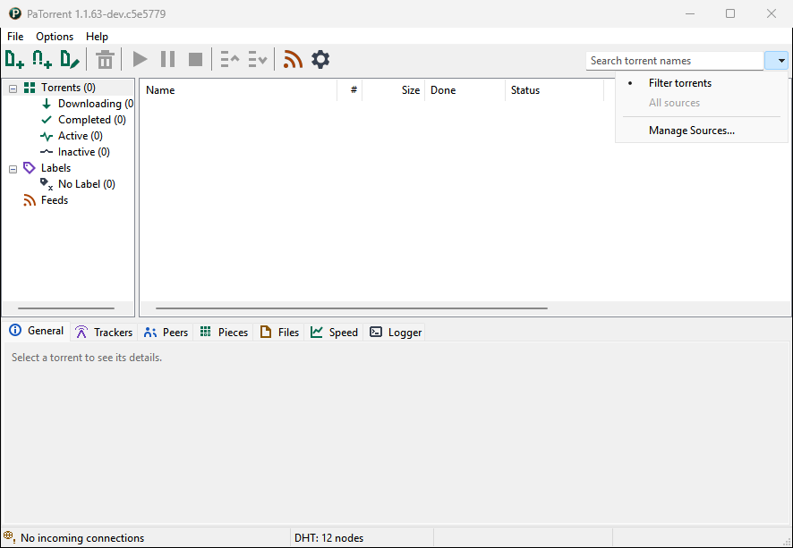
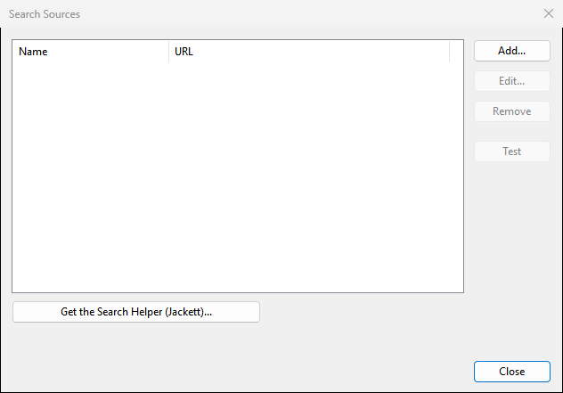
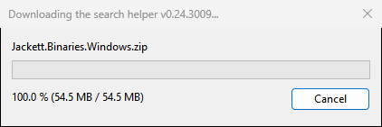
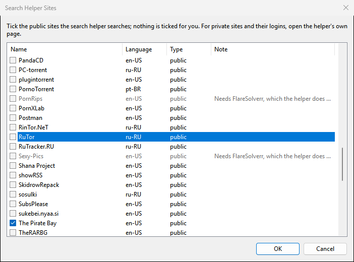
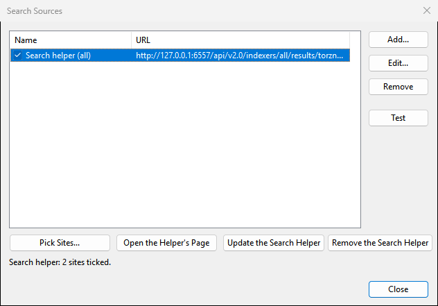
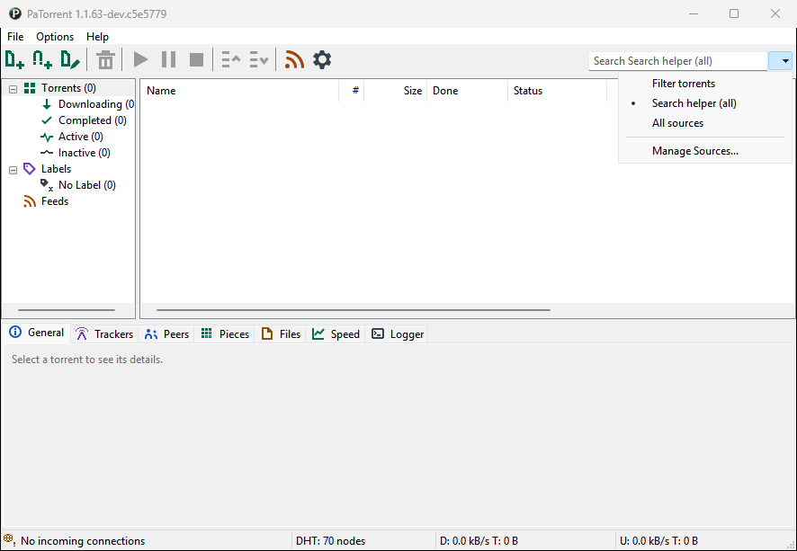
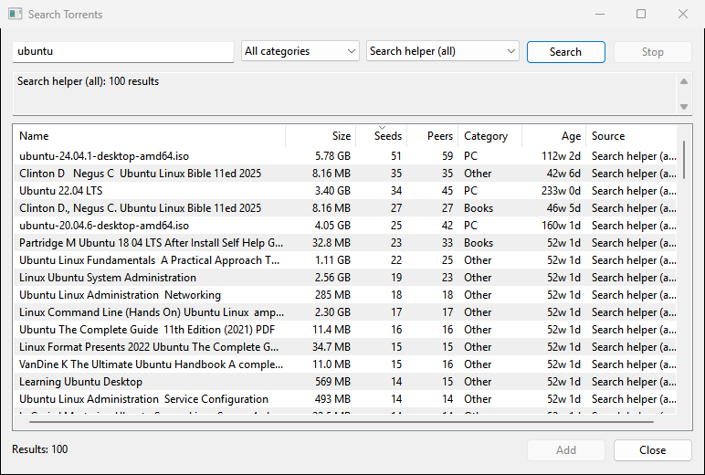

# Searching for torrents on Windows

A short guide to the search box in the Windows version of PaTorrent: how to get the search helper, pick the sites it searches, and add what it finds. Ten minutes and a 55 MB download, done once.

**Version:** the search helper is in PaTorrent 1.1.59 and newer. The 1.1.40 release has the search box and Manage Sources, but not the "Get the Search Helper" button; there, the last section (your own Prowlarr or Jackett) applies.

## What you get

PaTorrent has no search engine of its own. It asks a *search source*: a small program that knows how to search torrent sites. The easiest source is the **search helper**, which is [Jackett](https://github.com/Jackett/Jackett), a separate free program by its own authors. PaTorrent downloads it for you at a click, keeps it in its own folder, and runs it only while you search. You choose which public sites it searches. Nothing is downloaded or run until you click the button.

If you already run Prowlarr or Jackett yourself, you can use that instead: see the last section.

## 1. Open Manage Sources

The search box is at the top right of the main window. The small arrow beside it opens a menu. Choose **Manage Sources...**.

The Search Sources window opens. It is empty at first.

## 2. Get the search helper

Click **Get the Search Helper (Jackett)...**. PaTorrent looks up the newest Jackett release and asks before it downloads anything:

> The search helper is Jackett, a separate program by its own authors under the GPL-2.0 licence, downloaded from github.com/Jackett/Jackett (v0.24.3009, 54.5 MB).
>
> It goes into C:\Users\you\AppData\Roaming\PaTorrent\search-helper and runs on this computer only, only while you search. You then pick the public sites it searches.
>
> Download it now?

Click **Yes**. The download takes a few seconds to a minute, depending on your connection.

PaTorrent checks the file against the release's checksum, unpacks it and starts it once to read its site list. No Windows prompt appears: nothing needs administrator rights, and the helper listens on this computer only, so the firewall has nothing to ask about.

## 3. Tick the sites to search

The site list opens by itself (later, it is the **Pick Sites...** button). Nothing is ticked for you. Tick the public sites you want to search, then click **OK**.

- The greyed rows say "Needs FlareSolverr, which the helper does not include". Those sites sit behind a bot check that the helper cannot pass on its own; leave them.
- Two or three sites are enough to start. Every ticked site is asked on every search, so more sites mean slower searches and more duplicates.
- Private sites need their logins. The helper's own page handles those: see "Private sites" below.

Back in Search Sources, the helper is now listed as **Search helper (all)** with its buttons below, and the line at the bottom says how many sites are ticked. Click **Close**.

## 4. Search

Open the arrow's menu again and choose **Search helper (all)**. The search box's hint changes to match. (The first entry, **Filter torrents**, is the box's other job: narrowing your own torrent list by name. **All sources** asks every source you have at once.)

Type what you are looking for and press **Enter**. The Search Torrents window opens and the results come in within a few seconds.

- Click a column header to sort: Seeds high to low finds the healthy ones.
- The category box narrows the search to Movies, TV, Audio, PC, Books or Other. The source box and the Search button repeat the search from this window.
- Select a result and click **Add**, or double-click it. The torrent is added the way a magnet link is; with "Show a window that displays the files inside the torrent" on in Preferences, the Add New Torrent window opens first.
- To make the box filter your torrent list again, choose **Filter torrents** in the arrow's menu. The choice is remembered between starts.

That is the whole setup. The sections below are for later.

## Good to know

**It runs only while you search.** The helper starts at your first search and stops itself ten minutes after the last one. It closes with PaTorrent, however PaTorrent ends. It never starts on its own or at boot, and it listens only on this computer (`127.0.0.1`), never on your network.

**Where it lives.** The `search-helper` folder inside your PaTorrent settings folder: `%APPDATA%\PaTorrent\search-helper` normally, the folder with `patorrent.exe` in portable mode, and the profile's folder when you use profiles. Jackett's own settings and log are in its `data` subfolder.

**Proxy and VPN.** If you set a proxy in Preferences > Connection, the helper uses it for the sites too. The helper is a separate program, so "Use only this network" does not bind it: its requests to the sites take Windows' normal route, which is your VPN when the VPN carries all your traffic.

**Updating.** Nothing updates on its own. **Update the Search Helper** in Search Sources looks for a newer Jackett and asks before downloading it; your sites and settings stay.

**Removing.** **Remove the Search Helper** stops it, deletes its folder and takes its source out of the list. The **Get** button comes back. Deleting PaTorrent's settings folder removes it too.

**Private sites.** **Open the Helper's Page** opens Jackett's own page in your browser and copies its password to the clipboard (the page asks for it). There you can add a private site with your login, as in any Jackett. Sites added there are searched along with the ticked ones.

**Antivirus.** The download is Jackett's own release, checked against the checksum GitHub publishes for it. If an antivirus quarantines files from the `search-helper` folder, searches fail with "The search helper did not start"; restore the files or Remove and Get it again.

## If something goes wrong

| What you see | What it means |
|---|---|
| "Could not get the search helper: ..." | GitHub could not be reached (no connection, a proxy that blocks it) or the download was interrupted. Try again. |
| "The search helper did not start: ..." | The program in the `search-helper` folder could not run: a damaged download or an antivirus. Remove and Get it again. |
| A search finds nothing | No sites are ticked, or the ticked sites are down or changed. Pick Sites... shows what is ticked; try another site. |
| "Search helper (all): ..." with an error | One site failed; the others still answer. The message names the site. |
| The results window never opens | The box is in **Filter torrents** mode. Choose **Search helper (all)** or a source in the arrow's menu first. |

## Using your own Prowlarr or Jackett instead

If you run Prowlarr or Jackett already (on this PC, a NAS, a server), add it as a source and skip the helper:

1. In Search Sources click **Add...**.
2. **Name:** anything. **Torznab URL:** for Jackett, `http://host:9117/api/v2.0/indexers/all/results/torznab/`; for Prowlarr, an indexer's Torznab feed URL, `http://host:9696/1/api`, one source per indexer. **API key:** from Jackett's page, or Prowlarr's Settings > General.
3. Click **Test**: it should say "OK" and a number of categories. Then **OK**.

The API key is stored encrypted and never shown again. A source on your own computer or network is reached directly; a public one goes through your proxy, if you set one. The helper and your own sources can be used side by side: **All sources** in the arrow's menu asks them all.

For how the helper is built and what it does on the wire, see [SEARCH_HELPER.md](SEARCH_HELPER.md); for the Torznab search itself, part 2 of [INTEGRATIONS.md](INTEGRATIONS.md).
