# Rookparcel identity candidates

Generated 2026-11-05 using the built-in image generation tool. Twelve exploration sheets; each includes a logo, wordmark, light/dark app tiles and simplified mark studies. These are raster concept sheets, not production ICO/SVG files. No candidate is selected yet.

## Gallery

### 01-boxcastle — Boxcastle

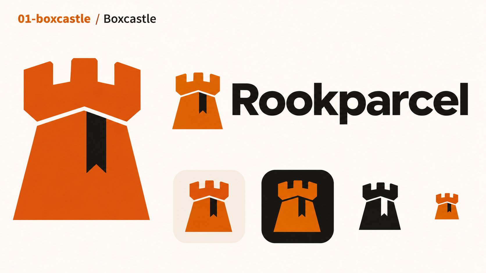

A chess rook built from one folded cardboard parcel: three battlements, broad tapering body, one packing tape seam. Burnt orange and ink black. Bold flat geometric silhouette.

### 02-courier-rook — Courier Rook

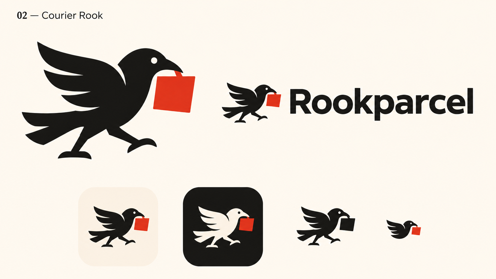

A compact black rook bird in profile carrying a vermilion square parcel in its beak. Wing and tail suggest forward movement. Warm ivory, ink black, vermilion. Sophisticated playful flat silhouette.

### 03-swarm-tower — Swarm Tower

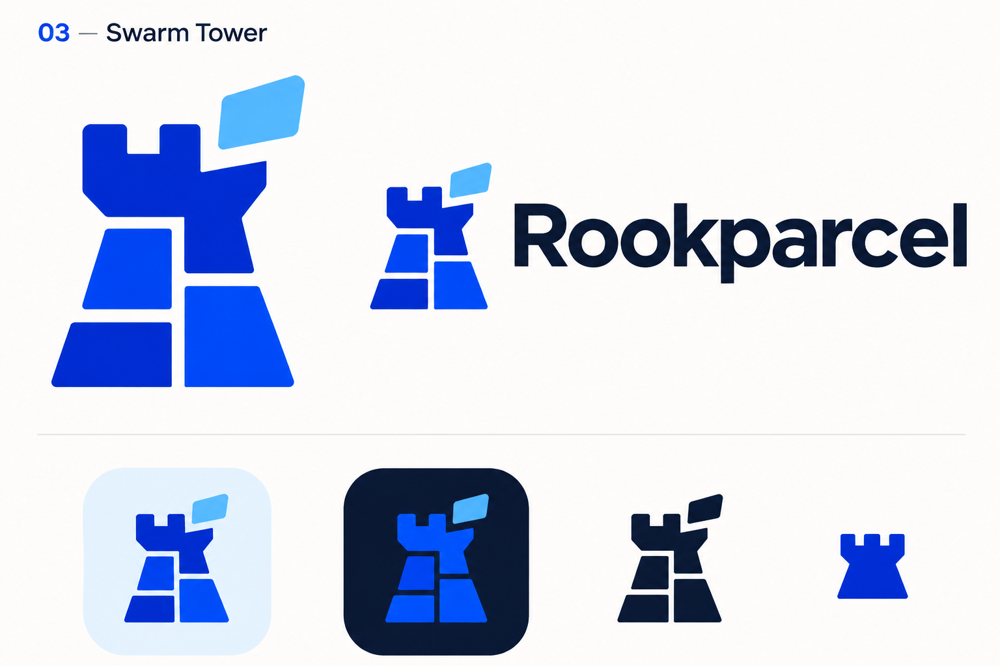

Four chunky interlocking cobalt blocks assemble into a chess rook, one block approaching the top suggests distributed file pieces. Cobalt and ice blue. Precise geometric tech identity, strong negative-space gaps.

### 04-parcel-wing — Parcel Wing

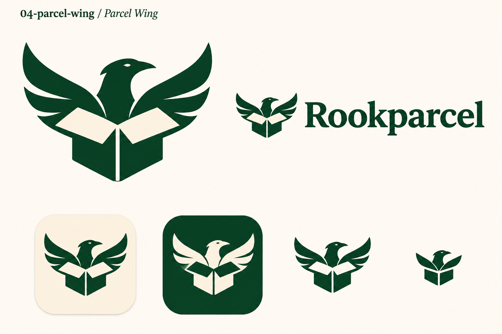

A folded parcel seen three-quarter view whose open flaps become swept rook bird wings. Forest green and warm ivory. Symmetrical bold emblem, refined outdoor-modern feel.

### 05-hidden-rook — Hidden Rook

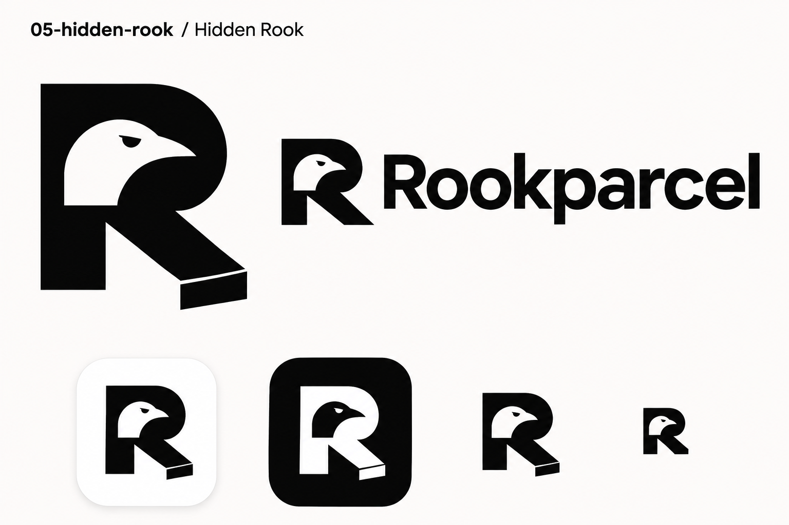

Heavy geometric capital R whose upper counter reveals a rook bird head and beak; diagonal leg resembles a folded box tab. Ingenious negative space. Strict monochrome black and white, Swiss modernist identity.

### 06-night-dispatch — Night Dispatch

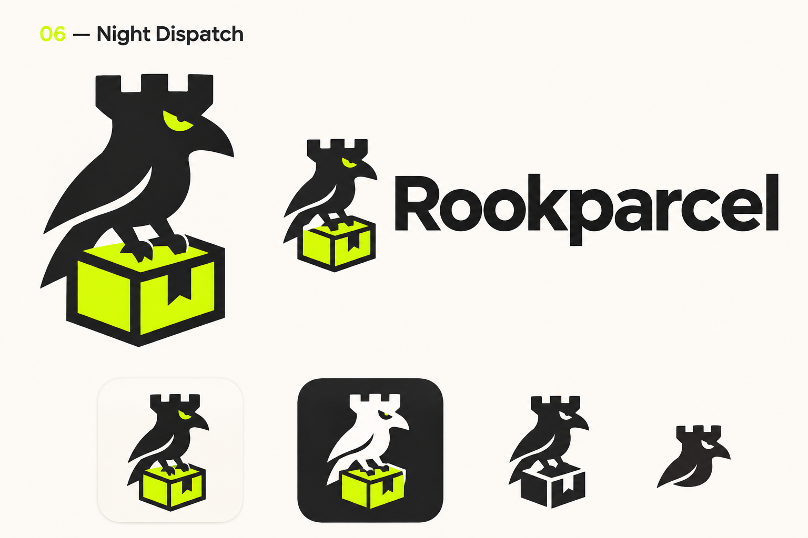

Sturdy mischievous rook bird perched on a square parcel; combined silhouette subtly resembles a chess rook. Electric chartreuse and charcoal, tiny eye cutout, striking compact shape.

### 07-verdigris-tower — Verdigris Tower

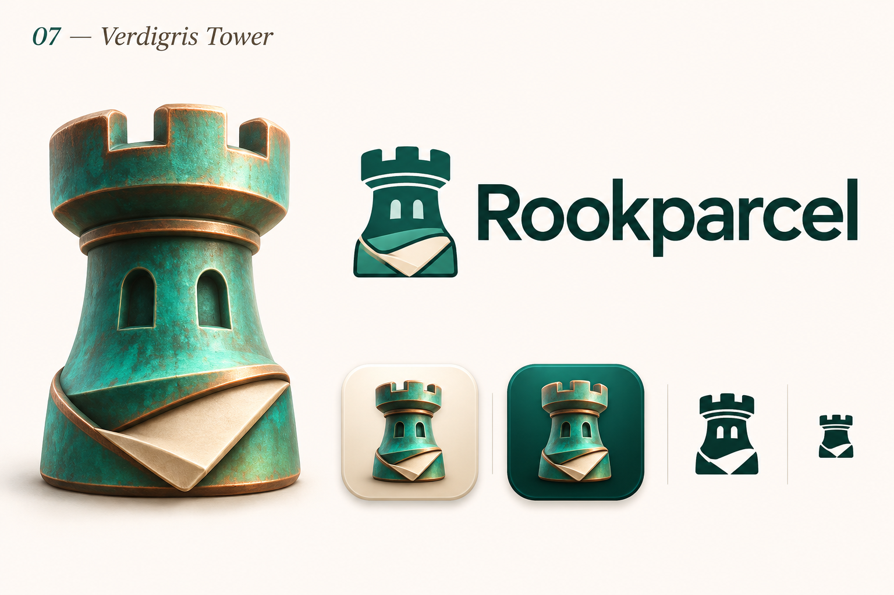

Premium sculpted chess rook made of patinated copper and verdigris enamel; base subtly folded like a parcel. Restrained 3D desktop app icon with lovely bevels, teal copper cream. Pair with a clean flat logo interpretation.

### 08-postal-rook — Postal Rook

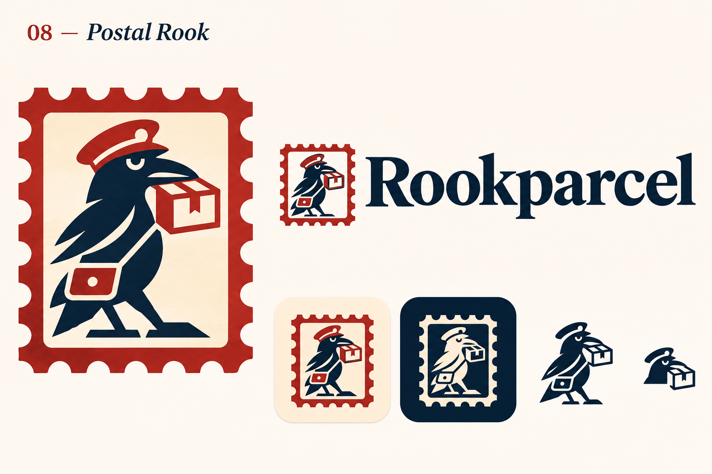

Rook bird and parcel reduced to a bold vintage postage-stamp emblem. Brick red, navy, warm paper. Punchy linocut geometry, slightly human character, finely tailored contemporary serif wordmark; avoid tiny decorative detail.

### 09-origami-courier — Origami Courier

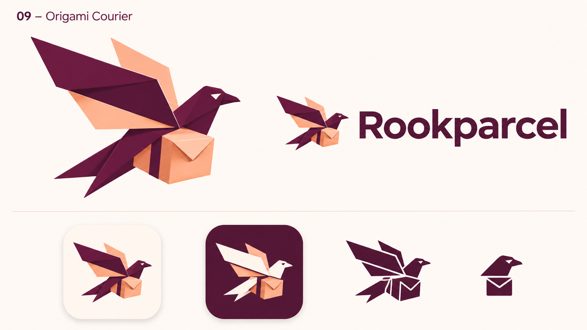

Elegant folded-paper rook bird formed from a single parcel wrapper. Angular broad wings, clever folded box torso. Aubergine and peach with warm white; minimal faceted icon, sophisticated and nimble.

### 10-pixel-rook — Pixel Rook

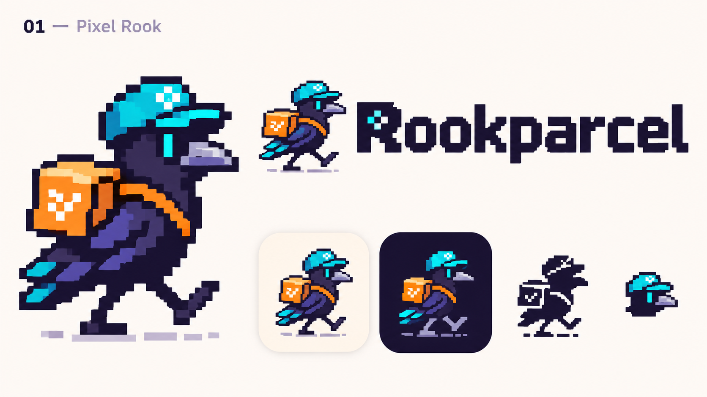

Delightful expertly crafted pixel-art rook bird courier with a tiny box backpack, chunky 16-bit silhouette, cyan orange midnight. Nostalgic desktop utility identity with custom pixel-inspired but highly legible wordmark.

### 11-orbital-parcel — Orbital Parcel

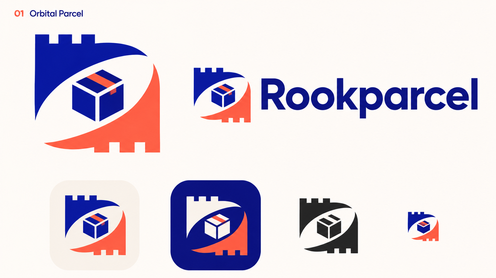

Unexpected abstract parcel cube inside two curved rook-wing forms that suggest peer-to-peer exchange and a lowercase r. Ultramarine and coral, graphic Bauhaus geometry, distinctive asymmetric balance. No literal network node spaghetti.

### 12-rooklet — Rooklet

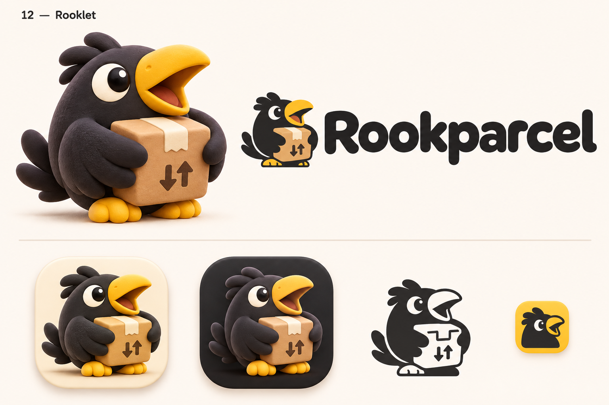

Lovable round black rook bird mascot hugging a kraft parcel, oversized confident beak, bright curious eye, compact silhouette. Tactile clay-rendered app icon, charcoal yellow cream; include a simplified flat emblem and rounded friendly custom wordmark.

## Review notes

- Strong starting points: 01 Boxcastle for a minimal app mark; 05 Hidden Rook for a monogram; 06 Night Dispatch for bird/chess wordplay; 12 Rooklet for a mascot.
- Generated sheet headings for 10 Pixel Rook and 11 Orbital Parcel mistakenly say 01; filenames and gallery numbering are authoritative.
- Fine details and variant consistency need refinement after selection; evaluate final icons at actual 16/24/32 pixel sizes. Generated vector-like marks are still raster images.

## Exact prompt set

Each call used the common prompt below followed by the candidate ID, ` / `, name, `. `, and its concept text above. All calls used `transparent_background: false`, with no input reference images.

Use case: logo-brand. Create one polished high-resolution landscape brand exploration sheet for the renamed desktop BitTorrent application Rookparcel. This is an original identity candidate, not a collage of unrelated alternatives. Layout: generous airy editorial grid on a clean warm-white background, upper left small candidate number and concept name, large hero symbol on left, carefully typeset horizontal symbol + exact wordmark 'Rookparcel' on right, lower row showing matching light app tile, dark app tile, a small monochrome silhouette and compact favicon-scale interpretation. All elements share the same design. Wordmark spelling exact: R-o-o-k-p-a-r-c-e-l, capital R only. No slogans or filler copy. Strong distinctive visual invention, professional brand designer quality, usable crisp contours and optically balanced proportions. Keep tiny versions deliberately simpler. Do not depict actual software UI or merchandise. Concept: 

## Cropped icons

Postal Rook is the owner's preferred direction. [25 multi-size ICO exports and preview](ico/README.md) | [Download all ICOs](rookparcel-ico-candidates.zip).

