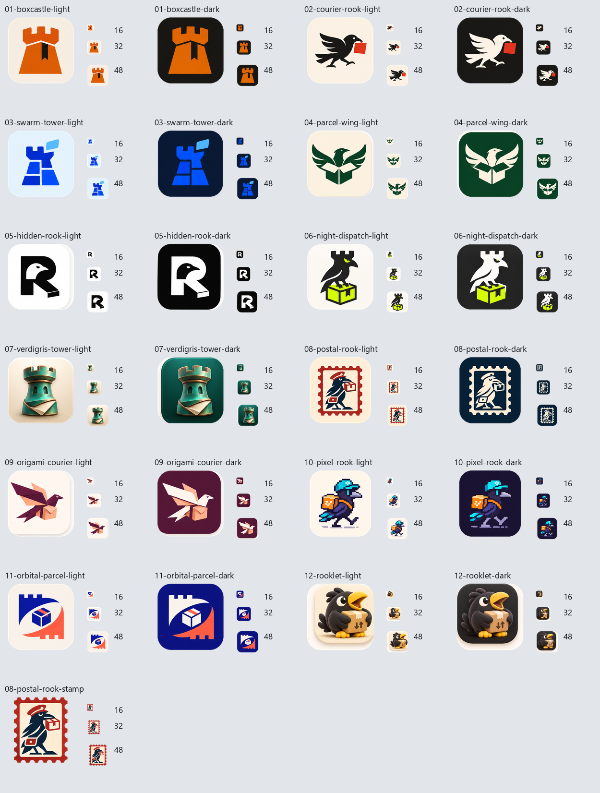

# Rookparcel ICO candidates

25 ICO files: light and dark tile crops for all 12 concepts, plus a transparent standalone Postal Rook stamp. Postal Rook is the owner's preferred direction.

Each ICO contains 16, 20, 24, 32, 40, 48, 64, 96, 128 and 256 pixel frames. Matching 512 px transparent PNG canvases are included. Tile corners are clipped to rounded silhouettes. The stamp retains its cream paper with transparent outer perforations.

These are crops of the generated artwork, resampled with Lanczos, not pixel-redrawn small icons. At 16 px the detailed postal bird becomes indistinct; dedicated small-size refinement remains useful. Production application resources have not been replaced.

See export_icons.py and crops.json for reproducible extraction coordinates.
