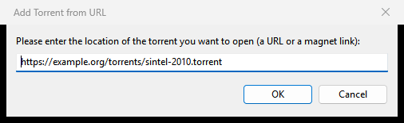
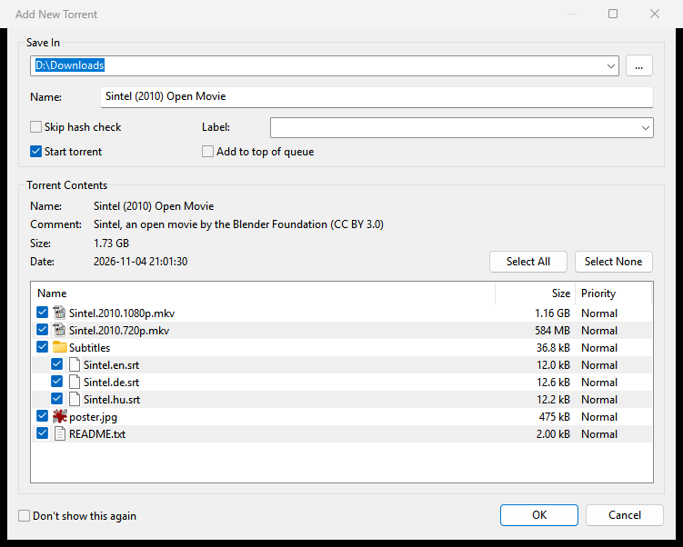

# Adding torrents

This page shows every way to give Rookparcel a torrent: a `.torrent` file, a magnet link, a web address, drag and drop, your browser and file manager, and a watched folder. It also explains the Add New Torrent window, where you pick the folder and the files before the download starts.

## The quick ways

| What you have | What to do |
|---|---|
| A `.torrent` file on your computer | **File > Add Torrent...** (<kbd>Ctrl</kbd>+<kbd>O</kbd>), or the first toolbar button. You can pick several files at once. |
| A magnet link | **File > Add Torrent from URL...** (<kbd>Ctrl</kbd>+<kbd>U</kbd>) and paste it. |
| A web address of a `.torrent` file (`http://` or `https://`) | **File > Add Torrent from URL...** and paste it. Rookparcel downloads the file and adds it. |
| A `.torrent` file in Explorer | Drag it onto the Rookparcel window, or double-click it if Rookparcel opens `.torrent` files. |
| A magnet link in your browser | Click it, if Rookparcel opens magnet links. |
| Many `.torrent` files that arrive over time | Let Rookparcel watch a folder. See [A watched folder](#a-watched-folder). |
| A search result | See [Searching for torrents](Searching-for-torrents). |

The tray icon's right-click menu also has **Add Torrent...** and **Add Torrent from URL...**.

## Add Torrent from URL

1. Copy the magnet link or the address of the `.torrent` file.
2. Choose **File > Add Torrent from URL...**. When the clipboard holds a link that starts with `magnet:`, `http://` or `https://`, the box is already filled in.
3. Click **OK**.

An address is downloaded in the background, through your proxy when Preferences > Connection sends tracker connections through one. Some sites answer the address with a magnet link instead of a file; Rookparcel follows that too. If the download fails, a message says "Could not download" with the address and the reason.

## Drag and drop

Drop one or more `.torrent` files from Explorer onto the main window. Each one is added as if you had picked it with **Add Torrent...**.

## From your browser and file manager

Rookparcel can be the program Windows uses for `.torrent` files and `magnet:` links. Turn this on in **Options > Preferences > General** with **Associate with .torrent files** and **Associate with magnet: links**, or in the [Setup Guide](First-start-and-the-Setup-Guide). See [Tray, notifications and startup](Tray-notifications-and-startup) for the details, including what to do when Windows keeps another program.

When Rookparcel is already running and you open a torrent from your browser or Explorer, the running Rookparcel takes it. With **Activate the program window** on (Preferences > UI Settings, on by default), the main window comes to the front as well; with it off, only the Add New Torrent window appears.

You can also start Rookparcel with torrents on the command line: `rookparcel.exe file.torrent "magnet:?xt=..."`. Each `.torrent` path, `magnet:` link and `http(s)://` address is added. If Rookparcel is already running, they go to the running window.

If the running Rookparcel was started with administrator rights, Windows does not let a second copy hand it a torrent. Rookparcel then tells you so; add the torrent from the running window, or start Rookparcel without administrator rights.

## The Add New Torrent window

With **Show a window that displays the files inside the torrent** on (Preferences > UI Settings, on by default), this window opens for every torrent you add. Turned off, torrents are added at once with the default folder and all files.

For a magnet link, the window opens once the torrent's file list has arrived from other peers. Until then the torrent waits in the list as "Downloading metadata". It writes nothing to disk while it waits. If you quit Rookparcel before the list arrives, the window comes back at the next start.

### Save In

The folder the torrent's files go into. The list holds the default download folder (from **Preferences > Directories > Put new downloads in:**) and the last ten folders you used. Type a path or click **...** to pick one. A folder that does not exist yet is created. The free space on that drive is shown after the size below.

**Name:** the name of the torrent's folder, or of its only file. Changing it renames the folder or file on disk.

### Torrent Options

| Option | What it does |
|---|---|
| **Skip hash check** | Treats the files already in the folder as complete, without checking them. Use it only when you know the data is complete and correct, for example after copying it from another computer. Greyed out for a magnet link: its files were already checked when the file list arrived. |
| **Start torrent** | On: the torrent goes into the queue and starts as the queue allows. Off: it is added stopped. It starts ticked unless **Don't start the download automatically** is on in Preferences > UI Settings. |
| **Add to top of queue** | Puts the torrent first in the queue, so it starts before the others. |
| **Label:** | Gives the torrent a label. Pick one in use or type a new one. See [Managing torrents](Managing-torrents#labels). |

### Torrent Contents

The top lines show the torrent's **Name:**, **Comment:**, **Size:** and **Date:**. The size says how much of the torrent you have selected, for example "1.20 GB of 3.40 GB selected", followed by the free disk space.

The file list shows the torrent's folders and files as a tree, each with a check box, its size and its priority.

- Untick a file to skip it. A folder whose files are partly ticked shows "Mixed".
- **Select All** and **Select None** tick or untick everything.
- Click a folder's icon, or double-click it, to open or close it. <kbd>Right</kbd> and <kbd>Left</kbd> (or <kbd>+</kbd> and <kbd>-</kbd> on the number pad) do the same; <kbd>Space</kbd> ticks or unticks the selected rows.
- Right-click selected rows for **High Priority**, **Normal Priority**, **Low Priority**, **Don't Download**, **Check** and **Uncheck**. Choosing a priority ticks the files; **Don't Download** unticks them.

You can change the file choices and priorities later in the [Files tab](Torrent-details-and-files#files).

### OK, Cancel and Don't show this again

**OK** adds the torrent with your choices. **Cancel** adds nothing; for a magnet link it removes the waiting torrent. Ticking **Don't show this again** turns off **Show a window that displays the files inside the torrent**, so later torrents are added without this window. Turn it back on in Preferences > UI Settings.

Rookparcel remembers the window's size.

## Adding torrents stopped

To add torrents without downloading anything until you say so, turn on **Don't start the download automatically** in **Options > Preferences > UI Settings**. New torrents are added stopped and outside the queue. Start them with **Start** when you are ready. In the Add New Torrent window this shows as **Start torrent** being unticked.

## A torrent that is already in the list

If you add a torrent that is already in the list, Rookparcel says "... is already in the torrent list." and adds nothing.

## A watched folder

Rookparcel can watch a folder and add every new `.torrent` file put there:

1. Open **Options > Preferences > Directories**.
2. Tick **Automatically load .torrents from:** and choose the folder.
3. Optionally tick **Delete loaded .torrents**.
4. Click **OK**.

Rookparcel adds a new file a few seconds after it stops changing, without the Add New Torrent window. A loaded file is renamed to `.torrent.loaded`, or deleted when **Delete loaded .torrents** is on. Problems are written to the [Logger tab](Torrent-details-and-files#logger).

The same page can keep a copy of every added `.torrent` file (**Store .torrents in:**). See [Disk and storage](Disk-and-storage) and the [Preferences reference](Preferences-reference).

## In the GTK version (Linux, BSD, macOS)

- The same menu items, shortcuts and Add New Torrent window.
- **Add Torrent from URL** fills in a link from the clipboard the same way. Text that is not a `magnet:` link or an `http(s)://` address gives "Not a link Rookparcel can add".
- The GTK window does not accept dropped files. Use **File > Add Torrent...**, or open the file with Rookparcel from your file manager.
- On Linux and BSD, the file associations are under **Desktop Integration** on Preferences > General. In a Flatpak, choose the default program in your desktop's settings instead. See [Tray, notifications and startup](Tray-notifications-and-startup).

## In the Web UI

- **Add Torrent** uploads one or more `.torrent` files from the computer the browser runs on; **Add URL** asks for a magnet link or an address. A bare info-hash is taken as a magnet link too.
- You can drop `.torrent` files or a magnet link onto the page, or paste a magnet link anywhere outside a text box.
- The same Add New Torrent window opens in the page. **Save In** is a folder on the server, typed as a path.
- On a phone, **Add URL** is in the **More** menu (⋯).

See [Web UI](Web-UI). In a window connected with **File > Connect to Remote...**, the **...** button in Add New Torrent is greyed out: type a folder on the server. See [Remote control](Remote-control).

## Related pages

- [The main window](The-main-window)
- [Managing torrents](Managing-torrents)
- [Importing from µTorrent and qBittorrent](Importing-from-uTorrent-and-qBittorrent)
- [RSS Downloader](RSS-Downloader)
