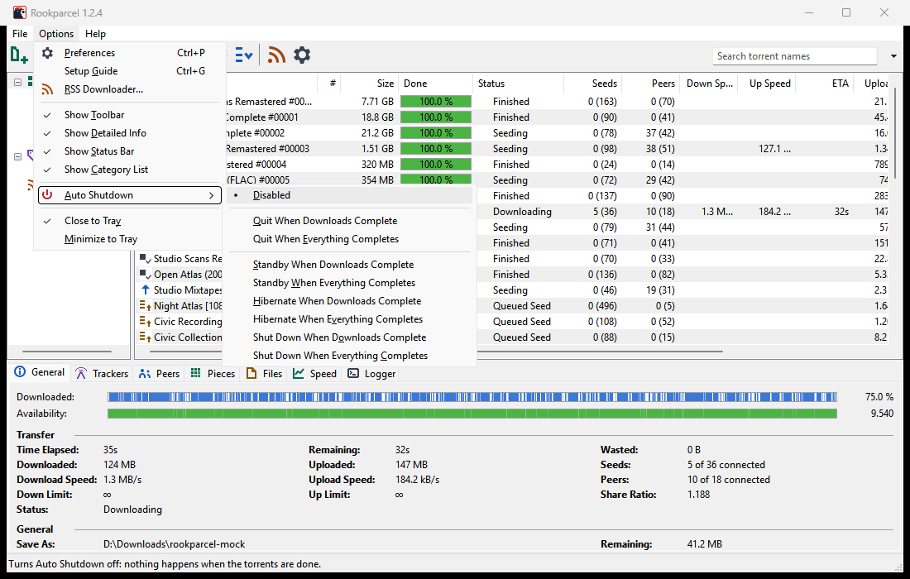

# Auto Shutdown

Auto Shutdown quits Rookparcel, or puts the computer on standby, hibernates it or shuts it down, once your torrents are done. This page covers the choices, what counts as "done", and the countdown before it acts.

## Choosing what happens

Open **Options > Auto Shutdown** and pick one item:

| Item | What happens when the work is done |
|---|---|
| **Disabled** | Nothing. This is the default. |
| **Quit When Downloads Complete** | Rookparcel quits once no started torrent is downloading any more. |
| **Quit When Everything Completes** | Rookparcel quits once no started torrent is downloading or seeding any more. |
| **Standby When Downloads Complete** | The computer goes on standby (sleep) once the downloads are done. |
| **Standby When Everything Completes** | The same, once nothing is downloading or seeding. |
| **Hibernate When Downloads Complete** | The computer hibernates once the downloads are done. |
| **Hibernate When Everything Completes** | The same, once nothing is downloading or seeding. |
| **Shut Down When Downloads Complete** | The computer shuts down once the downloads are done. |
| **Shut Down When Everything Completes** | The same, once nothing is downloading or seeding. |

The chosen item has a mark beside it. Standby or Hibernate are grey when Windows does not offer them on this computer (hibernation switched off, for example).

The choice lasts for this run only: every start of Rookparcel begins at **Disabled**, and after it has acted it is **Disabled** again.

## What counts as done

**Downloads complete** waits for every started torrent that has not finished downloading: running, forced or queued ones, including one that is checking, fetching a magnet link's file list, or held back by the scheduler. A torrent whose wanted files are all done counts as finished, even with skipped files left.

**Everything completes** also waits for every started torrent that is seeding or queued to seed. A seed completes when its [seeding goal](Queueing-and-seeding#seeding-goal) stops it. A seed with no goal, or a force-started one, seeds on and holds the shutdown back, so set a goal before you choose an "Everything" item.

In both cases:

- A stopped or paused torrent, or one with an error, does not count: it waits for you.
- A torrent whose files are being moved counts as work until the move is done.
- Auto Shutdown acts only after it has seen work while the item was chosen. Choosing it when nothing is left to do waits for the next download instead of acting at once.

## The countdown

When the work is done, a small **Auto Shutdown** window appears on top of all windows, even when Rookparcel is hidden in the tray. It says what completed and counts down from 30 seconds, for example:

> All downloads have completed.
> The computer will shut down in 0:30.

- Click **Cancel** (or press <kbd>Esc</kbd>) to call it off. Auto Shutdown is then **Disabled**.
- If new work arrives during the countdown, such as an RSS download, the countdown closes and waits until that work is done too; then a full countdown starts again.
- When the time is up, it acts.

The **Logger** tab records each step: "Auto Shutdown: done, ... in 30 s", "Auto Shutdown: cancelled, now Disabled", "Auto Shutdown: new work, the countdown is off until it is done".

## How each action is carried out

- **Quit**: Rookparcel exits as with **File > Exit**, saving the torrent list and progress on the way out.
- **Shut Down**: Rookparcel exits the same way first, then asks Windows to shut down and power off. Windows is not forced: a program with unsaved work can still hold the shutdown back.
- **Standby** and **Hibernate**: Rookparcel saves the torrent list and progress first, then puts the computer to sleep. It keeps running, and carries on when the computer wakes. Auto Shutdown is then **Disabled**.

If Windows refuses, a message says so, such as "Could not shut down the computer:" with the reason. A Windows account that is not allowed to shut the computer down gets this message.

## In the GTK window, on macOS and in rookparcel-nox

- **GTK window** (Linux, BSD): the same **Options > Auto Shutdown** menu and countdown. Standby, Hibernate and Shut Down go through the system's login manager (systemd-logind), which may ask for your password. Where it is missing (the BSDs, a system without systemd) or does not allow an action, those items are grey and only the Quit items are left.
- **macOS**: the same **Options > Auto Shutdown** menu and countdown. Standby and Shut Down ask macOS to sleep or shut down as the Apple menu does, with Apple events to the system's "loginwindow". The first time, macOS may ask whether Rookparcel may control "loginwindow"; click **OK**. If you refused, allow it in **System Settings > Privacy & Security > Automation**. The Hibernate items are grey: macOS has no hibernation of its own to ask for. *The native macOS app is not in a published release yet.*
- **Web UI**: has no Auto Shutdown.
- **rookparcel-nox**: start it with `--exit-when-done downloads` or `--exit-when-done all` to exit, with its state saved, once nothing is downloading, or nothing is downloading or seeding either. It waits until something has run first, as the menu does, and exits a few seconds after the work is done. It never puts the computer to sleep or shuts it down. See [Running rookparcel-nox](Running-rookparcel-nox).

## Related pages

- [Queueing and seeding](Queueing-and-seeding)
- [Speed limits and the scheduler](Speed-limits-and-scheduler)
- [Tray, notifications and startup](Tray-notifications-and-startup)
