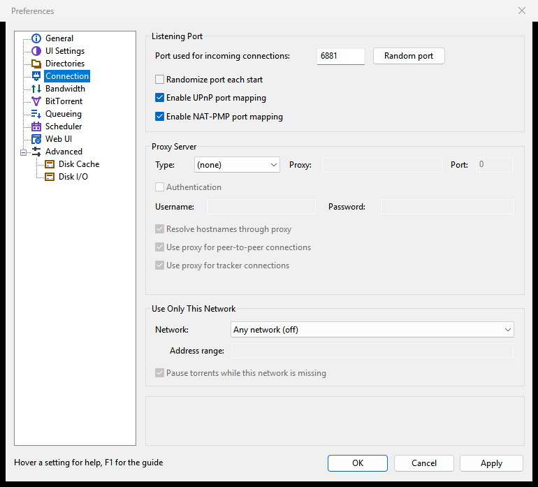
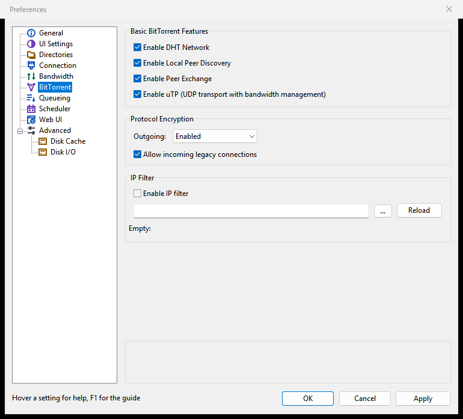

# Connection, ports and firewall

This page covers how other peers reach Rookparcel: the listening port, port forwarding with UPnP and NAT-PMP, the Windows firewall, how to tell whether incoming connections work, keeping torrent traffic on a VPN with "Use only this network", proxies, encryption, the IP filter, and the DHT, Peer Exchange and Local Peer Discovery.

Most of these settings are on **Options > Preferences > Connection** and **Options > Preferences > BitTorrent**.



## Why incoming connections matter

Rookparcel connects out to peers, and peers connect in to Rookparcel. Downloads work with outgoing connections alone, but a Rookparcel that others can reach finds more peers, and two peers that both cannot be reached cannot talk to each other at all. For good speeds, and for seeding, let peers in.

## The listening port

Under **Listening Port** on the Connection page:

| Setting | Meaning |
|---|---|
| **Port used for incoming connections:** | The port other peers connect to. A change applies at once. |
| **Random port** | Fills in a random port from 10000 to 60000. It is used once you apply it. |
| **Randomize port each start** | Picks a new random port from 10000 to 60000 at every start. A port forwarded by hand in the router then no longer matches. Off by default. |
| **Enable UPnP port mapping** | Asks a UPnP router to forward the port to this computer. On by default. |
| **Enable NAT-PMP port mapping** | Asks the router to forward the port through NAT-PMP or PCP, which many routers offer besides UPnP or instead of it. On by default. |

The default profile listens on port 6881. A new profile, or a portable copy, picks a random port from 10000 to 60000 at its first start, so it does not collide with another Rookparcel. See [Profiles](Profiles).

Rookparcel listens on TCP and UDP on the same port: UDP carries uTP peers and the DHT.

### Forwarding the port in the router

With UPnP or NAT-PMP on and a router that supports them, there is nothing to do: Rookparcel asks the router to forward the port and renews the request. If your router has them switched off, or misbehaves, turn both boxes off and forward the port by hand in the router's own settings: TCP and UDP, to this computer's address. Then leave **Randomize port each start** off, so the port stays the one you forwarded.

## The Windows firewall

Rookparcel does not add a Windows Firewall rule by itself. Windows normally asks the first time a program listens for incoming connections; allow Rookparcel there.

If you dismissed that question, or nothing asked, add a rule for the program from a Command Prompt run as administrator. For a one-user installation:

```bat
netsh advfirewall firewall add rule name="Rookparcel" dir=in action=allow program="%LOCALAPPDATA%\Programs\Rookparcel\rookparcel.exe"
```

For an installation for every user, the path is `C:\Program Files\Rookparcel\rookparcel.exe`; for the zip, wherever you unpacked `rookparcel.exe`. The Web UI's port needs the same rule when other computers should reach it: see [Web UI](Web-UI). For [rookparcel-nox](Running-rookparcel-nox) running as a service, see its page.

On Linux and the BSDs, allow the port in your firewall if you run one.

## Checking that peers can connect

The left part of the status bar tells you:

| Status bar | Meaning |
|---|---|
| **Network OK** | At least one peer has connected in. The port works. |
| **No incoming connections** | No peer has connected in yet. Normal for the first minutes after a start; if it stays, the port is not reachable. |
| **Port 6881 in use** (with your port number) | Another program, often another Rookparcel profile, holds the port, and Rookparcel listens on a later port where nothing is forwarded. Click it to open Preferences at Connection and choose another port. |

*"Port ... in use" is new in 1.1.45; not in a published release yet.*

Hold the pointer over that part to see **Your address as trackers see it:**, the public address trackers report back. The **General** tab shows the same line. *New in 1.1.58; not in a published release yet.*

Rookparcel has no built-in port test. If the status stays at "No incoming connections" with active torrents:

1. Check that the firewall allows Rookparcel (above).
2. Check that UPnP or NAT-PMP is on in Rookparcel and in the router, or forward the port by hand.
3. With "Use only this network" set to a VPN, peers can only reach you through the VPN's own port forwarding, if it has one: Rookparcel asks no port mapping of a VPN adapter.

See also [Troubleshooting and FAQ](Troubleshooting-and-FAQ).

## Use only this network (VPNs)

*New in 1.1.58; not in a published release yet.*

"Use only this network" keeps all torrent traffic on one network adapter, typically a VPN. Peers, the DHT, trackers and web seeds all go through it and nothing else. When the VPN drops, torrents wait instead of carrying on over your normal connection.

1. Connect your VPN.
2. Open **Options > Preferences > Connection**.
3. Under **Use Only This Network**, choose in **Network:**
   - **Any VPN adapter**: whatever adapter looks like a VPN tunnel (WireGuard, OpenVPN, a VPN app's own). This is what most people want.
   - One adapter by its name, from the list of this computer's adapters.
   - **Address range (below)**, then type the range in **Address range:**, such as `10.2.0.0/16` or `fd00::/8`.
   - **Any network (off)** turns it off; this is the default.
4. Leave **Pause torrents while this network is missing** ticked.
5. Click **OK** or **Apply**.

Which to choose:

- **Any VPN adapter** survives the VPN app renaming or recreating its adapter, which many do at every connect or update.
- **Address range** suits a VPN that always hands out addresses from the same range: the adapter holding an address in it carries the traffic, whatever it is called.
- **One adapter by name** is the narrowest choice. An adapter that is not there now shows as "(not connected)" in the list.

The rule is checked again at every network change, so a VPN that reconnects under a new address is followed.

**While the network is missing:** with **Pause torrents while this network is missing** on, running torrents wait. Their status shows **Waiting for the network**, the status bar starts with **Waiting for the network**, and the Logger says which rule found nothing. When the VPN is back they carry on by themselves. Stop and Start still work on them meanwhile. With the box off, nothing is paused, but no torrent traffic can leave either, since every connection needs the matched adapter.

**Checking it works:** hold the pointer over the status bar's network part, or look at the **General** tab: **Your address as trackers see it:** should show the VPN's address, not your own. It says "not known yet" until a tracker has answered.

Good to know:

- If the VPN carries only IPv4, Rookparcel uses no IPv6 for torrents while bound to it, so IPv6 cannot leak around the tunnel.
- The Web UI and remote connections to Rookparcel are not bound, so you can still reach them over your normal network.
- Proxy connections are not bound either. The search helper is a separate program and is not bound; see [Searching for torrents on Windows](Searching-for-torrents-on-Windows#good-to-know).
- In the Web UI, the same group is on **Preferences > Connection**. For rookparcel-nox at the command line: `--network vpn`, `--network adapter:ID`, `--network range:10.2.0.0/16`, or `off`; and `--no-pause-when-missing` to leave torrents running unbound.

## Proxy server

Under **Proxy Server** on the Connection page. The proxy fields are grey while **Type:** is **(none)**, the default.

| Setting | Meaning |
|---|---|
| **Type:** | **Socks4**, **Socks5** or **HTTP** (which tunnels everything but plain http requests through CONNECT). **(none)** connects directly. |
| **Proxy:** and **Port:** | The proxy server's host name or IP address, and its port, such as 1080 for many SOCKS servers. |
| **Authentication** with **Username:** and **Password:** | Logs in to the proxy. A SOCKS4 proxy gets only the user name. |
| **Resolve hostnames through proxy** | Lets the proxy look up the names of trackers and web seeds, so your own DNS server does not see them. |
| **Use proxy for peer-to-peer connections** | Sends connections to peers and web seeds through the proxy. Incoming connections are then refused, and port mapping and Local Peer Discovery stay off. uTP and the DHT need a SOCKS5 proxy. |
| **Use proxy for tracker connections** | Sends tracker announces through the proxy, so trackers see the proxy's address. |

The last three are ticked by default and count only once a proxy type is chosen. A SOCKS5 proxy from a VPN provider is one way to use a VPN without an adapter; "Use only this network" is the other.

## Protocol encryption

On **Options > Preferences > BitTorrent**, under **Protocol Encryption**:

| Setting | Meaning |
|---|---|
| **Outgoing:** | How the connections Rookparcel opens are encrypted. **Disabled**: never. **Enabled** (the default): plain and encrypted attempts alternate per peer, keeping what worked. **Forced**: encrypted only, losing peers that cannot encrypt. |
| **Allow incoming legacy connections** | Accepts incoming connections that are not encrypted. Off, only encrypted ones are accepted, which loses peers that cannot encrypt. On by default. |

Change these if your provider slows BitTorrent traffic down. The Advanced page has the finer settings (`out_enc_policy`, `in_enc_policy`, `allowed_enc_level`, `prefer_rc4`).



## DHT, Peer Exchange, Local Peer Discovery and uTP

Under **Basic BitTorrent Features** on the BitTorrent page, all on by default:

| Setting | Meaning |
|---|---|
| **Enable DHT Network** | Finds peers through the DHT, a network of BitTorrent clients, without a tracker. Most magnet links need it. |
| **Enable Local Peer Discovery** | Finds peers for the same torrents on your local network, so they exchange data directly at network speed. |
| **Enable Peer Exchange** | Lets connected peers tell each other about more peers. A change applies to every torrent. |
| **Enable uTP (UDP transport with bandwidth management)** | Connects to and accepts peers over uTP, a UDP transport that slows down when the network is busy, as well as over TCP. |

Private torrents never use the DHT, Peer Exchange or Local Peer Discovery, whatever these boxes say. A torrent's Properties can switch the DHT and Peer Exchange off for that torrent alone (**Enable DHT** and **Peer Exchange** under **Other Settings**).

The status bar shows **DHT: N nodes**, how many DHT nodes Rookparcel knows.

To allow only some connection types, such as TCP only, use `bt.transp_disposition` on the Advanced page: 1 outgoing TCP, 2 outgoing uTP, 4 incoming TCP, 8 incoming uTP, added together; 15 (the default) allows all, 5 is TCP only.

## IP filter

Under **IP Filter** on the BitTorrent page, Rookparcel can block peers by address, from a block list in eMule `ipfilter.dat` or PeerGuardian P2P format.

1. Tick **Enable IP filter**.
2. Choose the block list file in the box below. Left empty, Rookparcel uses `ipfilter.dat` in its settings folder.
3. Click **Reload** to load it now and see how many rules it holds ("N rules loaded."), or click **OK** to load it with the other settings.

The list is loaded at start and on Apply. The Logger writes "IP filter: N rules from ..." or the error. If a new list cannot be read, the rules loaded before stay in force.

By default the filter also applies to the DHT and to trackers at blocked addresses (`apply_filter_to_dht` and `apply_ip_filter_to_trackers` on the Advanced page). Turn the tracker one off if a tracker you need sits in a blocked range.

In the Web UI there is no Reload button: the list loads when you apply.

## In the GTK window and the Web UI

- **GTK window**: the same pages and settings. The status bar's network part says the same things, and a click on "Port ... in use" opens Preferences at Connection.
- **Web UI**: the same pages under **Preferences**; its status bar shows the network part with the same tooltip.
- **rookparcel-nox**: `--port N` sets the listening port (default 6881), `--listen` sets the listen interfaces in full, `--proxy TYPE://[USER:PASS@]HOST:PORT` sets a proxy, `--ip-filter FILE` loads a block list, and `--network` sets "Use only this network". A service on Windows needs a firewall rule for `rookparcel-nox.exe`: see [Running rookparcel-nox](Running-rookparcel-nox).

## Related pages

- [Speed limits and the scheduler](Speed-limits-and-scheduler)
- [Profiles](Profiles) (ports for several Rookparcels)
- [Troubleshooting and FAQ](Troubleshooting-and-FAQ)
- [Preferences reference](Preferences-reference)
