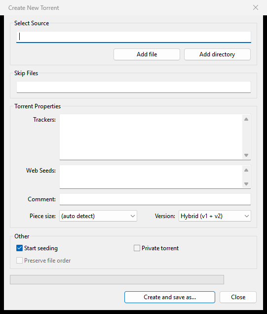

# Creating torrents

This page shows how to make a new `.torrent` file from a file or folder on your computer with the Create New Torrent window, what each option means, and how to start seeding it at once.



## Make a torrent in five steps

1. Choose **File > Create New Torrent...** (<kbd>Ctrl</kbd>+<kbd>N</kbd>), or the toolbar's **Create New Torrent** button.
2. Under **Select Source**, click **Add file** for a single file or **Add directory** for a folder. You can also type or paste the path.
3. Under **Torrent Properties**, add the trackers you want, one per line. Without trackers, peers can find each other only through the DHT and Peer Exchange.
4. Leave **Start seeding** ticked to share it straight away.
5. Click **Create and save as...**, pick where to save the `.torrent` file, and wait for the progress bar.

The suggested file name is the source's name plus `.torrent`. When hashing is done, the window closes. Share the `.torrent` file with the people who should download it.

## The options

### Select Source and Skip Files

**Select Source** is the file or folder the torrent is made from. A folder's name becomes the torrent's name.

**Skip Files** leaves files and folders out of the torrent by name. Write wildcard patterns, `*` for any run of characters and `?` for one, separated by `|` or `;`. Case does not matter. For example, `*.nfo|Thumbs.db|*.tmp` skips NFO files, Windows thumbnail caches and temporary files.

### Torrent Properties

| Option | Meaning |
|---|---|
| **Trackers:** | one tracker address per line. A blank line starts a new tier: later tiers are used when the trackers before them fail. Repeated addresses are dropped. |
| **Web Seeds:** | addresses of web servers that hold the same files, one per line. Peers can download from them as from a seed. |
| **Comment:** | a free text stored in the torrent; other programs show it, for example in the Add New Torrent window. |
| **Piece size:** | the size of each piece, from 16kB to 16MB. **(auto detect)** picks one from the total size and is the right choice for most torrents. |
| **Version:** | the BitTorrent version, see below. |

### Version: v1, v2 or hybrid

| Choice | What you get |
|---|---|
| **Hybrid (v1 + v2)** | the default. Loads in older v1-only programs and in newer ones that understand v2. |
| **v1** | the classic format, as µTorrent 2.2.1 made. Every BitTorrent program reads it. |
| **v2 only** | the newer format only. Programs that understand only v1 cannot load it. |

When in doubt, keep **Hybrid (v1 + v2)**.

### Other

| Option | Meaning |
|---|---|
| **Start seeding** | adds the new torrent to your list as soon as it is made, with the folder that holds the source as its download folder. Rookparcel checks the files and then seeds. |
| **Private torrent** | marks the torrent private: peers are found only through its trackers, never through the DHT, Peer Exchange or Local Peer Discovery. Private trackers ask for this. |
| **Preserve file order** | keeps a folder's files in the order Windows lists them instead of sorting them by name. Available only for **v1**: v2 and hybrid torrents always sort their files. |

## Progress and cancelling

While Rookparcel reads and hashes the files, the progress bar and percentage move and the other controls are greyed out. The **Close** button becomes **Cancel**: click it, press <kbd>Esc</kbd> or close the window to stop. Nothing is saved when you cancel.

If something goes wrong, a message says what. Common ones:

| Message | Meaning |
|---|---|
| "Please select a file or a directory to create the torrent from." | **Select Source** is empty. |
| "...: no files to put in the torrent (empty, or all skipped)." | the folder is empty, or **Skip Files** left nothing. |

## What Rookparcel remembers

The next time you open the window, it has the trackers, piece size, version, **Start seeding**, **Private torrent** and **Preserve file order** you used last. The source, skip patterns, web seeds and comment start empty.

## Seeding a torrent you made earlier

If you made a torrent without **Start seeding**, add the `.torrent` file like any other ([Adding torrents](Adding-torrents)) and set **Save In** to the folder that holds the source file or folder. Rookparcel checks the files and seeds them.

To help a brand new torrent spread, you can turn on **Initial Seeding** for it; see [Managing torrents](Managing-torrents#initial-seeding).

## In the GTK version (Linux, BSD)

The same window with the same options, under **File > Create New Torrent...** (<kbd>Ctrl</kbd>+<kbd>N</kbd>).

## In the Web UI and rookparcel-nox

The Web UI cannot create torrents: the files would have to be on the server. On the server itself, `rookparcel-nox create` makes a torrent from the command line:

```
rookparcel-nox create "D:\Share\My folder" -o my-folder.torrent -t udp://tracker.example.org:6969/announce
```

`--v1`, `--v2` and `--hybrid` pick the version (hybrid by default), `--private` marks it private, `--piece-size` sets the piece size in KiB, `-w` adds a web seed, and `--magnet` also prints the magnet link. `rookparcel-nox --help` lists all options. See [Running rookparcel-nox](Running-rookparcel-nox).

In a window connected with **File > Connect to Remote...**, **Start seeding** is unticked and greyed out: the torrent is made from files on this computer, which the server does not have. See [Remote control](Remote-control).

## Related pages

- [Adding torrents](Adding-torrents)
- [Managing torrents](Managing-torrents)
- [Connection, ports and firewall](Connection-ports-and-firewall)
