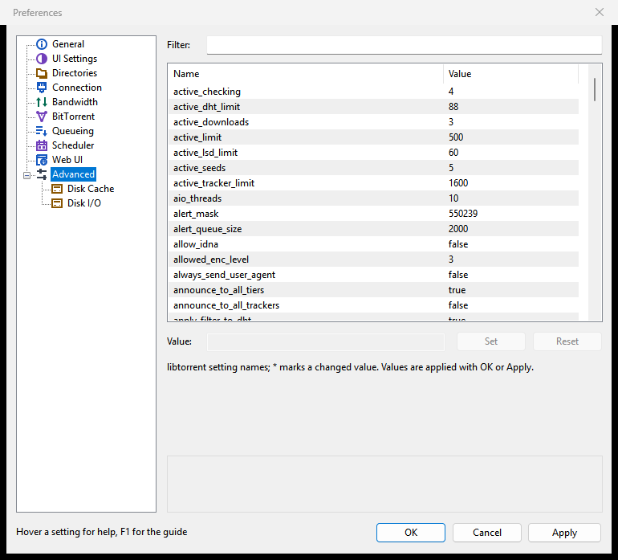

# Disk and storage

This page covers where Rookparcel puts downloads and how it moves them, and how it treats your disks: smart disk I/O (gentle checks, tuning per drive type, slowing down while a disk is busy) and the disk read cache.

## Where downloads go

On **Options > Preferences > Directories**, under **Location of Downloaded Files**:

| Setting | Meaning |
|---|---|
| **Put new downloads in:** | The folder new torrents are saved in, unless you choose another one in the Add New Torrent window. |
| **Move completed downloads to:** | When a torrent finishes downloading, its files move to the folder below and it keeps seeding from there. |
| **Append the torrent's label** | Beside the box above: a finished torrent with a label moves into a folder named after the label, inside the folder for completed downloads. |
| **Only move from the default download directory** | Moves only torrents saved in the folder for new downloads; torrents you saved somewhere else stay where they are. On by default. |

The Setup Guide asks for the download folder at the first start: see [First start and the Setup Guide](First-start-and-the-Setup-Guide).

The same page also keeps copies of .torrent files and loads them from a watched folder (**Location of .torrents**): see [Adding torrents](Adding-torrents).

### Moving completed downloads

1. Tick **Move completed downloads to:** and choose the folder.
2. Tick **Append the torrent's label** if you sort by labels, for example `D:\Done\Movies` for torrents labelled "Movies". A torrent without a label goes straight into the folder.
3. Decide on **Only move from the default download directory** (above).
4. Click **OK**.

It applies to torrents that finish from now on; torrents finished before stay where they are. While a torrent's files move, its status shows **Moving** and the **Logger** says "moving the completed download to ...". The label a torrent has when it finishes counts, so set labels before the download completes.

### Moving a torrent yourself

Right-click torrents and choose **Advanced > Set Download Location...** to pick a folder and move their files there. Files of the same name already in that folder are replaced. The item is grey while the torrent is already moving. A single file of a torrent can be moved from the Files tab's **Relocate...**: see [Torrent details and files](Torrent-details-and-files).

### Closing while files move

If you quit while files are moving, the closing window waits for the moves, with their progress, since stopping in the middle could leave a torrent half in one folder and half in the other. **Quit Now** asks first and says what it would undo: the torrent's files stay in the old folder, what was copied to the new one is deleted, and you can move it again later.

## Smart disk I/O

Smart disk I/O keeps the computer responsive while Rookparcel reads and writes. Its settings are on **Options > Preferences > Advanced > Disk I/O** (a page under Advanced in the page list).

The Setup Guide's **Use smart disk I/O** box turns all four parts on or off together. Gentle checks and per-drive tuning are on from the start; the box adds the slow-down while a disk is busy. *The Setup Guide is new in 1.1.62; not in a published release yet. The Disk I/O page itself is in 1.1.40.*

### Checking

A check (for example after **Force Re-Check**) reads every piece from disk and compares it with the torrent. Under **Checking**:

| Setting | Meaning | Default |
|---|---|---|
| **Check torrents gently (low priority, give way to other programs)** | Checks at the system's background disk priority, leaves other programs' cached files alone and pauses while reads are slower than usual, so the computer stays responsive. Checks take longer while the disk is busy. | On |
| **Limit checking to (MB/s):** | Caps each check's reading speed, for a disk that still lags during gentle checks. Here 1 MB is 1,000,000 bytes. | Off, 100 |
| **Drives checked at once (one torrent per drive):** | How many drives are checked at the same time, one torrent per drive; torrents on the same drive wait their turn. From 1 to 8. | 4 |

Checks of torrents on different drives run side by side; two torrents on one drive are checked one after the other, so the drive does not seek between them. The status shows **Queued for checking** for a torrent waiting its turn, then **Checking** with the percentage.

### Drives

| Setting | Meaning | Default |
|---|---|---|
| **Tune for the drive type (SSD, hard disk, network)** | Detects whether each save folder is on an SSD, a hard disk, a removable drive or a network share. A hard disk or removable drive then gets at most two disk jobs at once, a network server four, so they do not thrash. | On |

The Logger lists the drives it found at start, as "Disk I/O: drive D: (HDD, SATA)". USB bridges, RAID controllers and virtual machines often report the wrong type.

**Correcting a wrong guess.** Use `drive_overrides` on **Options > Preferences > Advanced**: comma-separated `path=type` pairs, the type one of `ssd`, `hdd`, `network` or `removable`, for example `D:/=hdd, E:/=removable`. The longest matching path wins.

1. Open **Advanced** and type `drive_overrides` in **Filter:**.
2. Select the row, type the pairs in **Value:** and click **Set**.
3. Click **OK** or **Apply**.

### When the disk is busy

Under **When the Disk Is Busy**, both off by default:

| Setting | Meaning |
|---|---|
| **Slow downloads down (disk writes)** | While a drive answers writes clearly slower than usual, halves the download rate step by step, never below 50 kB/s, and lets it grow again once the disk is quiet. |
| **Slow uploads down (disk reads)** | The same for uploads, while a drive answers reads slowly. Seeding then uploads less, which matters on trackers that count your ratio. |

They never raise your own limits. The slow-down is one cap per direction, shared with [Keep ping low](Keep-ping-low): the lower cap wins. While it holds a direction back, the status bar shows it as "(auto ...)", and the Logger has a line for it.

## Disk cache and files

**Options > Preferences > Advanced > Disk Cache** has the read cache and the disk queue. Most people never need to change them.

Under **Disk Read Cache**:

| Setting | Meaning | Default |
|---|---|---|
| **Enable caching of disk reads** | Keeps recently read pieces in memory, reading a block peers ask for together with its neighbours, which saves disk seeks when seeding. | On |
| **Override the automatic cache size (MB):** | Uses the size beside instead of the automatic 32 MB. A bigger cache can help busy seeding, at the cost of memory. | Off |
| **Remove blocks unused for more than (seconds):** | Drops cached blocks no peer has asked for in that time. Off, they stay until newer blocks push them out. | On, 300 |

Writes are left to the system's own cache.

Under **Disk Queue and Files**:

| Setting | Meaning | Default |
|---|---|---|
| **Disk write queue (kB):** | How much downloaded data may wait to be written to disk; above it, Rookparcel stops reading from peers until the disk catches up. Values below 4 MB act as 4 MB. | 1024 |
| **Maximum number of open files:** | The most files kept open at once; others are closed and opened again when needed. Raise it when many torrents or files are busy at once. | 40 |
| **Disk I/O threads (used from the next start):** | The threads that read and write torrent data. | 10 |
| **Hashing threads (used from the next start):** | Kept for compatibility; this version does not use it. Checks run one per drive, set on the Disk I/O page. | |

## In the GTK window and the Web UI

- **GTK window** (Linux, BSD): the same Directories, Disk Cache and Disk I/O pages. Drive types are detected on Linux, macOS and FreeBSD too, each with the system's own methods.
- **Web UI**: the same pages under **Preferences**, with **Disk Cache** and **Disk I/O** under **Advanced**. Folders there are folders on the computer running Rookparcel, not on the browser's.
- **rookparcel-nox**: `--save DIR` sets the download folder and `--move-on-complete DIR` moves finished torrents; the other settings are in the Web UI's Preferences.

## Related pages

- [Queueing and seeding](Queueing-and-seeding)
- [Where Rookparcel keeps its files](Where-Rookparcel-keeps-its-files) (settings and torrent state, not downloads)
- [Managing torrents](Managing-torrents)
- [Preferences reference](Preferences-reference)
