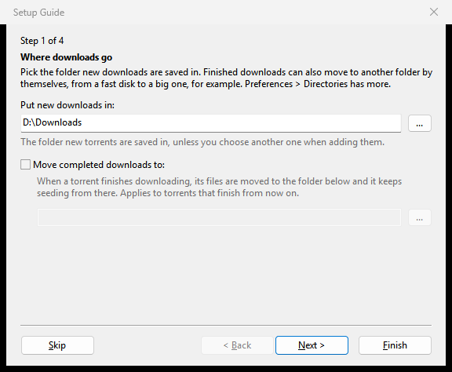

# First start and the Setup Guide

This page covers what happens the first time you start PaTorrent: the Setup Guide, a short window with four questions, what each answer sets, and how to open the guide again later.

*New in 1.1.62; not in a published release yet.* In 1.1.40 there is no guide: PaTorrent opens with its default settings, and everything below is set in **Options > Preferences** instead.

## When the guide opens

The Setup Guide opens by itself at the first start of PaTorrent: when its settings file has no settings in it yet. That is a new installation, a new portable folder, and every new [profile](Profiles). It opens before the main window, so nothing starts downloading before you have answered.

It does not open by itself for someone who already used an older version: the settings are there. Open it from the menu instead (below).

## Moving through it

Each page has a title, "Step 1 of 4" above it, a short text and its settings. The buttons:

| Button | What it does |
|---|---|
| **< Back** | the page before |
| **Next >** | the next page |
| **Finish** | saves your answers and closes the guide |
| **Skip** | closes the guide and keeps the settings as they are. <kbd>Esc</kbd> and the window's close box do the same |

Nothing is saved until **Finish**, and **Finish** changes only the answers you changed. Rest the mouse on a setting to see what it does; the help also shows under the settings.

After **Finish** or **Skip** the guide does not open by itself again.

## Page 1: Where downloads go

Pick the folder new downloads are saved in.

| Setting | Meaning |
|---|---|
| **Put new downloads in:** | the folder for new downloads. The default is your Downloads folder; in a portable folder it is the `Downloads` folder inside it |
| **Move completed downloads to:** | when ticked, finished downloads move to the folder beside it by themselves, from a fast disk to a big one, for example |

**Options > Preferences > Directories** has more folder settings. See [Disk and storage](Disk-and-storage).

## Page 2: Your router

Every connection to a peer takes a place in your router's connection table. Older routers and the basic boxes of internet providers have small tables; when one fills up, the router drops connections, slows down the whole house or restarts.

**Which router do you have?**

- **Modern (bought after about 2015), or not sure:** PaTorrent's normal numbers of connections.
- **Older, or the internet provider's basic box:** fewer connections: 100 in all, 40 per torrent, and 8 new ones a second.

The older answer is a starting point. You can change these numbers later in **Options > Preferences > Bandwidth** and **Advanced**. Answering modern later puts the normal numbers back.

The same page has **Keep ping low (limit speeds automatically)**. Tick it if you play games or make calls while PaTorrent runs: it holds the speeds down while your line is busy. See [Keep ping low](Keep-ping-low).

## Page 3: Your disks

**Use smart disk I/O** keeps the computer responsive while PaTorrent reads and writes:

- checks run at the system's background disk priority;
- each drive is tuned for its type (SSD, hard disk, network share);
- transfers slow down while a disk answers slowly.

Gentle checks and the tuning per drive are on from the start. The box adds the slow-down while a disk is busy. Checks take longer while something else uses the disk. **Options > Preferences > Advanced > Disk I/O** sets each part on its own. See [Disk and storage](Disk-and-storage).

## Page 4: This computer

PaTorrent can start when you sign in, and open `.torrent` files and `magnet:` links from your browser and file manager.

| Setting | Meaning |
|---|---|
| **Start PaTorrent on system startup** | starts PaTorrent when you sign in |
| **Associate with .torrent files** | double-clicking a `.torrent` file opens it in PaTorrent |
| **Associate with magnet: links** | clicking a `magnet:` link in the browser opens it in PaTorrent |

**Options > Preferences > General** changes these later. See [Tray, notifications and startup](Tray-notifications-and-startup).

This page is left out where it does not apply:

- **The Windows installer** already asked about the associations, so an installed copy shows three pages at its first start. The page is there when you open the guide from the menu.
- **The Flatpak** shows only the startup box: the desktop decides which program opens `.torrent` files and `magnet:` links. So does macOS where PaTorrent cannot set the associations itself (a named profile, or a bare binary outside `PaTorrent.app`).

## Opening the guide again

Choose **Options > Setup Guide**, or press <kbd>Ctrl</kbd>+<kbd>G</kbd>. The guide shows your current settings, and **Finish** applies the answers you changed, as **OK** in Preferences does.

## GTK and the Web UI

- The GTK version (Linux, the BSDs, macOS) has the same guide, with the same pages, at the first start of each profile and under **Options > Setup Guide** (<kbd>Ctrl</kbd>+<kbd>G</kbd>).
- `patorrent-nox` and the Web UI have no guide. Set them up in the Web UI's Preferences: see [Web UI](Web-UI) and [Running patorrent-nox](Running-patorrent-nox).

## After the guide

The main window opens. Next steps:

- [Adding torrents](Adding-torrents)
- [The main window](The-main-window)
- [Connection, ports and firewall](Connection-ports-and-firewall), if downloads stay slow
- [Preferences reference](Preferences-reference), for every other setting
