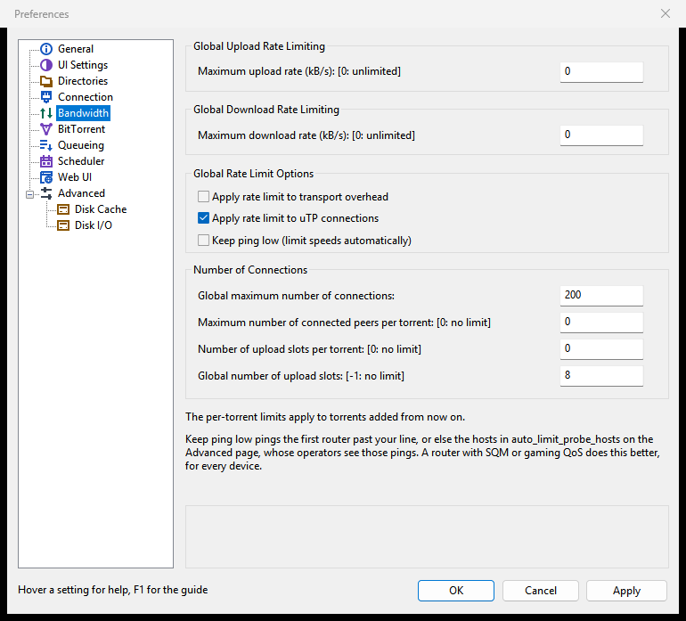

# Keep ping low

Keep ping low is PaTorrent's "gamer mode": it watches the delay on your internet line and holds PaTorrent's speeds down while the delay grows, so games, video calls and web browsing stay responsive while torrents run. This page explains what it does, how to turn it on and what you see while it works.

## Why torrents raise your ping

Your line's upload is usually its narrowest part. When PaTorrent sends faster than the line can carry, the packets wait in a queue in the modem or router, and every other packet waits behind them: a game's, a call's, a web page's. That queue is what you notice as lag. Sending a little slower than the line keeps the queue empty and the ping at its idle value. The download direction has the same problem at your provider's end of the line.

Keep ping low does not need to know which game runs. It measures the queue itself, so it works for any game, call or other program.

## Turning it on

1. Open **Options > Preferences** (<kbd>Ctrl</kbd>+<kbd>P</kbd>) and choose **Bandwidth**.
2. Under **Global Rate Limit Options**, tick **Keep ping low (limit speeds automatically)**.
3. Click **OK** or **Apply**.

It is off by default. To turn it off again, untick the box: your own limits are back at once.

When you first turn it on, PaTorrent learns your line's idle ping. That takes up to about 20 seconds, during which speeds may start lower.

## What it does

- **It measures the delay.** PaTorrent pings the first router past your home line about four times a second (a few hundred bytes a second). If no router past the line answers, it pings the hosts in the Advanced setting `auto_limit_probe_hosts` instead, by default `1.1.1.1,8.8.8.8,9.9.9.9`. Busy uTP peers give a second measurement at no extra traffic.
- **It caps both directions.** While the delay stays above its idle value by more than the allowance, the upload or download cap is lowered; while the line is quiet again, the cap grows step by step.
- **It never raises your own limits.** The lower of the automatic cap and your own global limit is used. Your settings are not changed.
- **It has floors.** The cap does not sink below about 10 kB/s, or below a small share of the highest rate seen, so a busy Wi-Fi or another program's upload cannot starve PaTorrent completely.
- **uTP gives way sooner.** While it is on, uTP connections aim for at most 25 ms of queueing delay instead of the usual 100 ms.

The note under the box says it too: those pings go to the first router past your line, or else to the fallback hosts, whose operators see them.

## What you see

- **The status bar.** While a direction is capped below your own limit, its part shows the cap in brackets, for example **U: 412.0 kB/s (auto 450.0 kB/s) T: 2.1 GB**. Without a cap it looks as usual.
- **The Logger tab.** Lines starting with "Keep ping low:" say which router or hosts it pings, and when a direction is limited or no longer limited.
- **The Web UI** shows the same "(auto ...)" in its status bar.

Speeds that are lower than your line's maximum while this is on are expected: that margin is what keeps the ping low.

## Fine-tuning

Two settings on **Options > Preferences > Advanced** belong to it. Select the row, enter the value, click **Set**, then **OK** or **Apply**.

| Setting | Meaning | Default |
|---|---|---|
| `auto_limit_delay_ms` | Milliseconds of extra ping allowed above the line's idle ping before the caps are lowered. Lower keeps games and calls smoother; higher allows more speed. | 15 |
| `auto_limit_probe_hosts` | Comma-separated IP addresses to ping when no router past the line answers. Read when the feature is switched on. Rarely needs changing. | `1.1.1.1,8.8.8.8,9.9.9.9` |

`utp_target_delay` (default 100) is the uTP delay target the feature lowers to 25 while it is on.

## Platforms

| System | How it measures |
|---|---|
| Windows | Pings, no administrator rights needed, plus the uTP peers. |
| Linux | Pings through the system's unprivileged ping sockets, plus the uTP peers. If the system does not allow them, the Logger says "this system does not let PaTorrent ping (its group must be in net.ipv4.ping_group_range)" and only the uTP peers are used. |
| macOS | Pings, plus the uTP peers. |
| FreeBSD and other systems without unprivileged pings | The uTP peers only. The Logger says pings are not available. |

With uTP peers only, it needs at least three busy uTP peers to measure anything; seeding only to TCP peers gives it nothing to go on.

## When something else is better

A router with SQM (such as CAKE) or a working gaming QoS does this better, for every device in the house, not only for PaTorrent. If you have one, you can leave Keep ping low off.

## Related features

- The busy-disk slow-down on **Advanced > Disk I/O** uses the same kind of automatic cap, for a slow disk instead of a slow line; the lower of the two caps wins. See [Disk and storage](Disk-and-storage#when-the-disk-is-busy).
- The Setup Guide's router page mentions Keep ping low for games and calls: see [First start and the Setup Guide](First-start-and-the-Setup-Guide).
- Fixed limits and the weekly scheduler: [Speed limits and the scheduler](Speed-limits-and-scheduler).

## In the GTK window and the Web UI

The GTK window (Linux, BSD, macOS) has the same box on **Preferences > Bandwidth**, and the Web UI has it on its **Preferences > Bandwidth** page, with the same note. In [patorrent-nox](Running-patorrent-nox) it is the same setting, `auto_rate_limit`, set from the Web UI's Preferences.
