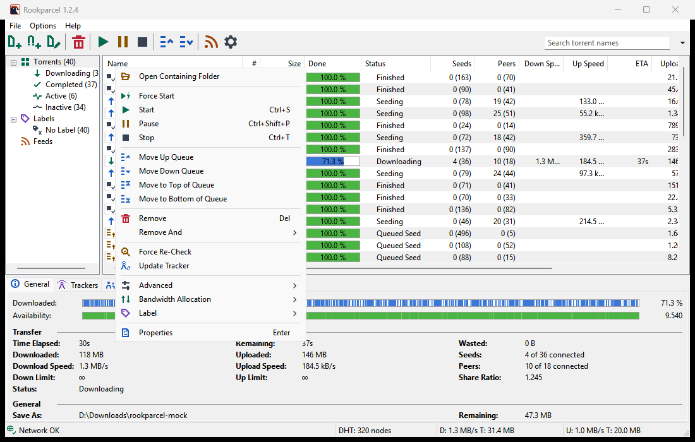

# Managing torrents

This page covers what you do with torrents once they are in the list: starting and stopping them, the queue, removing them with or without their files, checking them again, moving their files, labels, per-torrent speed limits, and the right-click menu that holds all of it.

Every action works on the selected torrents. Select several with <kbd>Ctrl</kbd>+click or <kbd>Shift</kbd>+click, or all of them with <kbd>Ctrl</kbd>+<kbd>A</kbd>, and act on them in one go.

## The right-click menu

Right-click a torrent (or press <kbd>Shift</kbd>+<kbd>F10</kbd>) for this menu:

| Item | Does | Key |
|---|---|---|
| **Open Containing Folder** | opens the torrent's folder in Explorer, with its data selected | |
| **Force Start** | starts now, outside the queue | |
| **Start** | hands the torrent to the queue | <kbd>Ctrl</kbd>+<kbd>S</kbd> |
| **Pause** | halts it and takes it out of the queue; shows **Paused** | <kbd>Ctrl</kbd>+<kbd>Shift</kbd>+<kbd>P</kbd> |
| **Stop** | stops it and takes it out of the queue; shows **Stopped** or **Finished** | <kbd>Ctrl</kbd>+<kbd>T</kbd> |
| **Move Up Queue**, **Move Down Queue** | one place up or down | |
| **Move to Top of Queue**, **Move to Bottom of Queue** | to the top or bottom, keeping their order | |
| **Remove** | removes it from the list; the files stay | <kbd>Del</kbd> |
| **Remove And > Delete Data** | removes it and deletes its files | <kbd>Shift</kbd>+<kbd>Del</kbd> |
| **Force Re-Check** | checks the files on disk again | |
| **Update Tracker** | contacts the trackers now | |
| **Advanced > Set Download Location...** | moves its files to another folder | |
| **Advanced > Initial Seeding** | turns initial seeding on or off | |
| **Bandwidth Allocation > Set Download Limit / Set Upload Limit** | its own speed limits | |
| **Label** | gives it a label, a new one, or none | |
| **Properties** | trackers, limits, seeding goal and more | <kbd>Enter</kbd> |

The sections below explain each group. Most of these are also on the toolbar; see [The main window](The-main-window#the-toolbar).

## Start, Pause, Stop and Force Start

Rookparcel keeps a queue, as µTorrent does. How many torrents may run at once is set in **Options > Preferences > Queueing**; see [Queueing and seeding](Queueing-and-seeding).

- **Start** hands the torrent to the queue. If there is room, it runs (**Downloading** or **Seeding**). If not, it waits as **Queued** or **Queued Seed** until a place frees up.
- **Force Start** runs the torrent at once, even when the queue is full. Its status starts with **[F]**, for example **[F] Seeding**. A forced torrent never reaches a seeding goal, so it seeds until you stop it.
- **Pause** and **Stop** both halt the torrent and take it out of the queue. The only difference is the word in the Status column: **Paused**, or **Stopped** (**Finished** for a complete torrent). Both are remembered after a restart. Start or Force Start it to carry on.

The tray icon's menu has **Start All Torrents** and **Stop All Torrents**, which act on every torrent in the list.

To add new torrents stopped, see [Adding torrents](Adding-torrents#adding-torrents-stopped).

## The queue

The **#** column shows each torrent's place in the queue. Lower numbers get a turn first. Use **Move Up Queue** and **Move Down Queue** (also on the toolbar), or **Move to Top of Queue** and **Move to Bottom of Queue**, to change the order. Moving several torrents keeps their order among themselves.

In the Add New Torrent window, **Add to top of queue** puts a new torrent first.

## Removing torrents

- **Remove** (<kbd>Del</kbd>) takes the torrents out of the list. The downloaded data stays on disk.
- **Remove And > Delete Data** (<kbd>Shift</kbd>+<kbd>Del</kbd>) takes them out and deletes their downloaded files. On Windows the files skip the Recycle Bin and cannot be recovered from it.

With **Confirm when deleting torrents** on (Preferences > UI Settings, on by default), Rookparcel asks first and says whether the files are deleted too. Turned off, Remove acts at once.

## Force Re-Check

**Force Re-Check** reads the torrent's files on disk piece by piece and counts only the pieces that are complete and correct. The status shows **Queued for checking**, then **Checking** with a percentage. Use it after you moved or restored files by hand, or when you suspect damaged data.

How gently checks use the disk is set in **Preferences > Advanced > Disk I/O**; see [Disk and storage](Disk-and-storage).

## Update Tracker

**Update Tracker** contacts the torrent's trackers now, without waiting for the next announce, to report progress and get more peers. The [Trackers tab](Torrent-details-and-files#trackers) shows the answer.

## Moving the files: Set Download Location

1. Select the torrents.
2. Choose **Advanced > Set Download Location...**.
3. Pick the new folder.

Rookparcel moves the files there and keeps seeding or downloading from the new place. The status shows **Moving** meanwhile, and the item is greyed out for a torrent that is already moving. Files of the same name already in the new folder are replaced.

If you quit while files are moving, Rookparcel waits for the moves to finish and shows their progress. **Quit Now** stops a move: its files stay in the old folder, and what was already copied is deleted. Move it again later.

To move finished downloads automatically, see **Move completed downloads to:** on [Disk and storage](Disk-and-storage).

## Opening the folder

**Open Containing Folder** opens the torrent's folder in Explorer, with its file or folder selected once it exists. With several torrents selected, it opens the first one's. Double-clicking a finished torrent does the same.

To open a single file, use the [Files tab](Torrent-details-and-files#files).

## Labels

A label is a name you give torrents to group them, such as "Movies" or "Linux". Each label in use appears under **Labels** in the category list, with a count, so a click shows only those torrents.

- **Label > New Label...** asks for a name and gives it to the selected torrents.
- **Label >** *a label* gives an existing label.
- **Label > Remove Label** takes the label off.

The menu ticks the label the selected torrents share. You can also give a label in the Add New Torrent window, and RSS filters can give one.

With **Append the torrent's label** on next to **Move completed downloads to:** (Preferences > Directories), a finished labelled torrent moves into a folder named after its label. See [Disk and storage](Disk-and-storage).

## Speed limits for one torrent

**Bandwidth Allocation > Set Download Limit** and **Set Upload Limit** offer **Unlimited**, 10, 25, 50, 100, 250, 500, 1000, 2500 and 5000 kB/s. The current choice is ticked. For any other number, use [Properties](Torrent-details-and-files#torrent-properties). The global limits in Preferences still apply on top. See [Speed limits and scheduler](Speed-limits-and-scheduler).

## Initial Seeding

**Advanced > Initial Seeding** is for a torrent you are the first to share. Each peer gets pieces no one else has yet, so a new torrent spreads faster. It can be turned on only when every selected torrent is seeding. The status shows **[S] Seeding** while it is on. Choose it again to turn it off.

## Properties

**Properties** (<kbd>Enter</kbd>, or double-click a torrent that is not finished) opens the Torrent Properties window: trackers, speed limits, upload slots, the seeding goal, and DHT and Peer Exchange for this torrent. See [Torrent details and files](Torrent-details-and-files#torrent-properties).

## In the GTK version (Linux, BSD, macOS)

- The same right-click menu, in the same order.
- Shortcuts: <kbd>Delete</kbd> removes, <kbd>Shift</kbd>+<kbd>Delete</kbd> removes and deletes the files, <kbd>Ctrl</kbd>+<kbd>A</kbd> selects all. Start, Pause and Stop have no shortcut.
- **Open Containing Folder** opens the folder in your file manager.
- On Linux and BSD, deleted files are removed from the disk, not moved to the trash.

## In the Web UI

- The same right-click menu, except that **Open Containing Folder** is greyed out ("not from a browser").
- **Set Download Location** asks for a folder on the server, typed as a path.
- Deleted files are removed from the disk, not moved to the trash.
- On a phone, the menu leaves out **Open Containing Folder** and starts with **Details**.

## In a remote window

In a window connected with **File > Connect to Remote...**, the files are on the other computer. **Open Containing Folder** is greyed out, and **Set Download Location...** asks for a folder on the server. See [Remote control](Remote-control).

## Related pages

- [The main window](The-main-window)
- [Torrent details and files](Torrent-details-and-files)
- [Queueing and seeding](Queueing-and-seeding)
- [Keyboard shortcuts](Keyboard-shortcuts)
