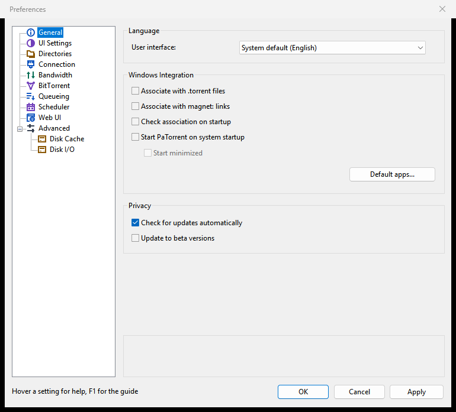
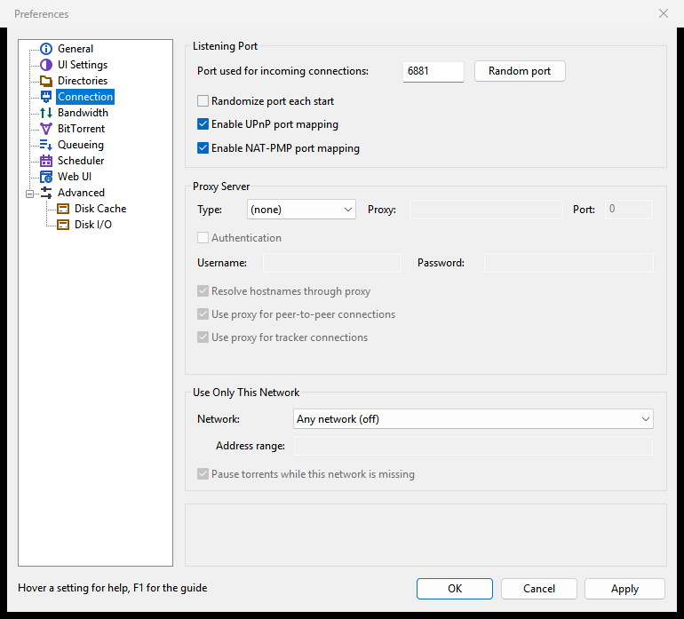
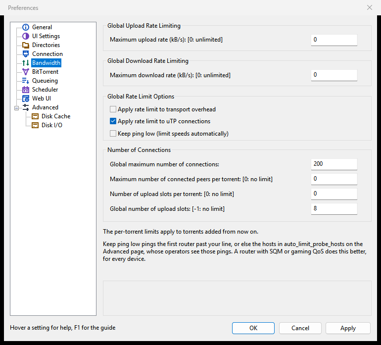
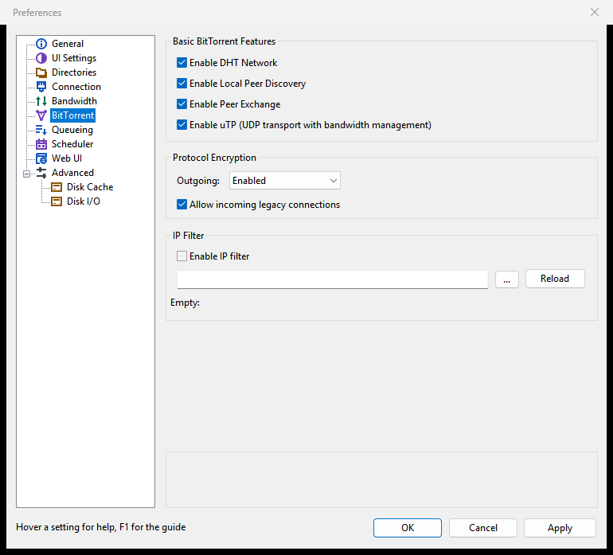
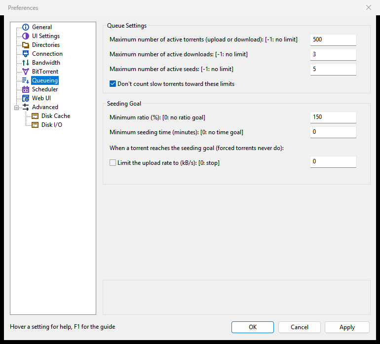
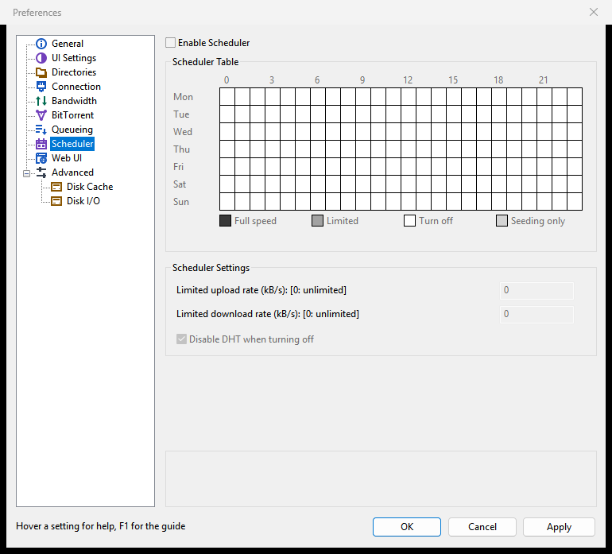
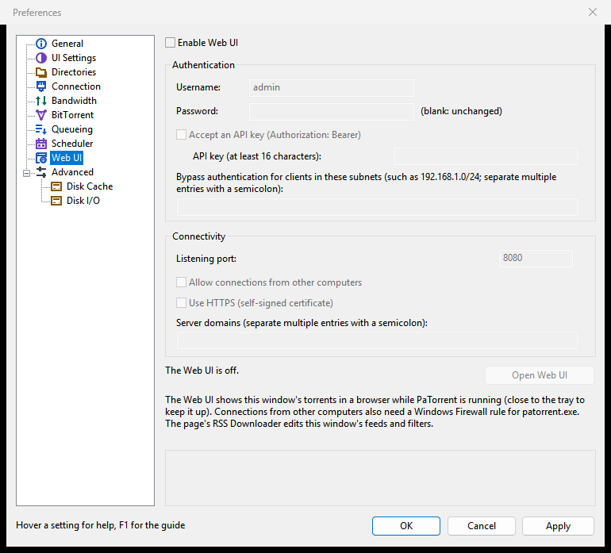
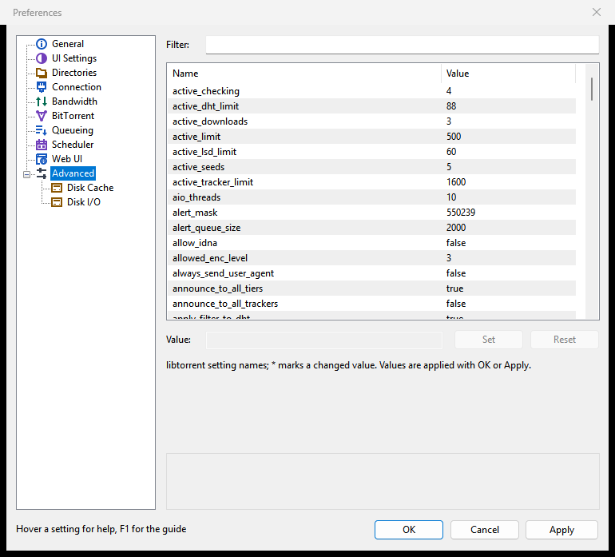

# Preferences reference

This page lists every page of the Preferences window and what each setting on it does, in the order the window shows them. Each section links to the page that explains the topic in full.

## Opening Preferences

Open **Options > Preferences**, press <kbd>Ctrl</kbd>+<kbd>P</kbd>, or click **Preferences** on the toolbar. The pages are listed on the left; **Disk Cache** and **Disk I/O** sit under **Advanced**. **OK** saves and closes, **Apply** saves and keeps the window open, **Cancel** forgets the changes.

Help is built in:

- Point at a setting and a tooltip explains it. The pane under the pages shows the same text for the setting under the pointer, or else for the one that has the keyboard focus.
- Press <kbd>F1</kbd> and the focused setting's help appears beside it.

*The help texts, tooltips and F1 are new in 1.1.57; not in a published release yet.*

The texts below are short versions of that built-in help. Rates on the pages are in kB/s; 0 means unlimited unless the label says otherwise.

## General

| Setting | What it does |
|---|---|
| **User interface:** (Language) | The language of menus, dialogs and the Web UI. The first choice follows the system's language. The desktop windows switch at their next start. |
| **Associate with .torrent files** | Makes this copy of PaTorrent the program that opens `.torrent` files, for your user account only. A program chosen in the system's own default apps settings wins over this. |
| **Associate with magnet: links** | Makes this copy of PaTorrent the program that opens `magnet:` links clicked in a browser, for your user account only. With profiles, only one profile can hold them. |
| **Check association on startup** | At start, asks whether to take over `.torrent` files and `magnet:` links when PaTorrent is not the program that opens them. Off by default. |
| **Start PaTorrent on system startup** | Starts PaTorrent when you log in. Each profile has its own entry. |
| **Start minimized** | With the automatic start, PaTorrent starts without showing its window, in the tray where there is one. |
| **Default apps...** (Windows only) | Opens Windows Settings at Default apps. A program chosen there wins over the boxes above, and only you can change that choice. |
| **Check for updates automatically** (Privacy) | About ten seconds after start and then every 12 hours, asks the project website whether a newer release is out. Nothing is downloaded or installed without asking. **Help > Check for Updates** works either way. |
| **Update to beta versions** (Privacy) | Also offers pre-release (beta) versions when checking for updates. |

On Windows the integration boxes are under **Windows Integration**; in the GTK version the group is called **Desktop Integration**.

More: [Tray, notifications and startup](Tray-notifications-and-startup), [Adding torrents](Adding-torrents), [Updating PaTorrent](Updating-PaTorrent), [Profiles](Profiles).

## UI Settings

| Setting | What it does |
|---|---|
| **Confirm when deleting torrents** | Asks before removing torrents from the list, saying whether their files are deleted too. Off, **Remove** acts at once. |
| **Alternate list background color** | Shades every other row of the lists. |
| **Show current speed in the title bar** | Puts the current download and upload speeds at the start of the main window's title, which also shows on the taskbar. |
| **Show balloon notifications in tray** | Shows a notification, with the torrent's name, when a download completes. |
| **Close to tray** (System Tray) | The window's close button hides PaTorrent in the tray instead of exiting, so transfers go on. Exit from the menu or the tray icon's menu. |
| **Minimize to tray** (System Tray) | Minimizing hides the window in the tray instead of the taskbar. Click the tray icon to bring it back. |
| **Don't start the download automatically** (When Adding Torrents) | New torrents are added stopped and outside the queue, so nothing is downloaded until you start them. |
| **Activate the program window** | Brings the main window to the front when another program, such as a browser, hands PaTorrent a torrent. Off, only the Add New Torrent window comes up. |
| **Show a window that displays the files inside the torrent** | Opens the Add New Torrent window for each torrent you add, to choose the folder and the files first; for a magnet link, once its file list has arrived. Off, torrents are added at once with the defaults. |

More: [Tray, notifications and startup](Tray-notifications-and-startup), [Adding torrents](Adding-torrents), [Managing torrents](Managing-torrents), [The main window](The-main-window).

## Directories

| Setting | What it does |
|---|---|
| **Put new downloads in:** | The folder new torrents are saved in, unless you choose another one when adding them. |
| **Move completed downloads to:** | When a torrent finishes downloading, its files are moved to this folder and it keeps seeding from there. Applies to torrents that finish from now on. |
| **Append the torrent's label** | Moves a finished torrent that has a label into a folder named after the label, inside the folder for completed downloads. |
| **Only move from the default download directory** | Moves only torrents saved in the folder for new downloads; torrents you saved somewhere else stay where they are. |
| **Store .torrents in:** | Keeps a copy of every added `.torrent` file in this folder, named after the torrent. A magnet link's copy is stored once its metadata has arrived. |
| **Move .torrents for finished jobs to:** | When a torrent finishes downloading, its stored `.torrent` copy moves to this folder. |
| **Automatically load .torrents from:** | Watches this folder and adds each new `.torrent` file put there, without the Add New Torrent window. A loaded file is renamed to `.torrent.loaded`. |
| **Delete loaded .torrents** | Deletes an automatically loaded `.torrent` file once its torrent is added, instead of renaming it. |

More: [Disk and storage](Disk-and-storage), [Adding torrents](Adding-torrents), [Queueing and seeding](Queueing-and-seeding).

## Connection

| Setting | What it does |
|---|---|
| **Port used for incoming connections:** | The port other peers connect to. Allow it in the firewall and forward it in the router, or let UPnP or NAT-PMP do that. A change applies at once. |
| **Random port** (button) | Fills in a random port from 10000 to 60000. It is used once you apply it. |
| **Randomize port each start** | Picks a new random port at every start. A port forwarded by hand in the router then no longer matches. |
| **Enable UPnP port mapping** | Asks a UPnP router to forward the listening port to this computer. Turn it off when you forward the port yourself or the router misbehaves. |
| **Enable NAT-PMP port mapping** | Asks the router to forward the port through NAT-PMP or PCP, which many routers offer besides UPnP or instead of it. |
| **Type:** (Proxy Server) | The kind of proxy: **Socks4**, **Socks5** or **HTTP**. **(none)** connects directly. |
| **Proxy:** and **Port:** | The proxy server's host name or IP address, and the port it listens on (such as 1080 for many SOCKS servers). |
| **Authentication**, **Username:**, **Password:** | Logs in to the proxy. A SOCKS4 proxy gets only the user name. |
| **Resolve hostnames through proxy** | Lets the proxy look up the names of trackers and web seeds, so your own DNS server does not see them. |
| **Use proxy for peer-to-peer connections** | Sends connections to peers and web seeds through the proxy. Incoming connections are then refused, and port mapping and Local Peer Discovery stay off; uTP and the DHT need a SOCKS5 proxy. |
| **Use proxy for tracker connections** | Sends tracker announces through the proxy, so trackers see the proxy's address instead of yours. |
| **Network:** (Use Only This Network) | Keeps all torrent traffic on one network adapter: **Any VPN adapter**, one adapter by name, or **Address range (below)**. **Any network (off)** turns this off. The Web UI and remote connections are not bound. |
| **Address range:** | A range such as `10.2.0.0/16` or `fd00::/8`, for the **Address range** choice: the adapter holding an address in it carries the torrent traffic. |
| **Pause torrents while this network is missing** | While no adapter matches (the VPN is down), running torrents wait and show "Waiting for the network", then carry on by themselves. |

*The Use Only This Network group is new in 1.1.58; not in a published release yet.*

More: [Connection, ports and firewall](Connection-ports-and-firewall).

## Bandwidth

| Setting | What it does |
|---|---|
| **Maximum upload rate (kB/s)** | The most all torrents together upload per second. 0 means unlimited. The scheduler's Limited hours and Keep ping low can lower it for a while. |
| **Maximum download rate (kB/s)** | The same for downloads. |
| **Apply rate limit to transport overhead** | Counts the TCP/IP headers of peer traffic against the limits, so they match what the line carries. Off by default. |
| **Apply rate limit to uTP connections** | Applies the limits to uTP peers too. Off, uTP peers are slowed only by uTP's own delay control. On by default. |
| **Keep ping low (limit speeds automatically)** | Measures the delay on your line and caps uploads and downloads automatically while it grows, for games and calls. It never raises your own limits; the status bar shows the cap as "auto". |
| **Global maximum number of connections:** | The most peer connections open at once across all torrents. Lower it if the router struggles. |
| **Maximum number of connected peers per torrent** | The most peers one torrent connects to; 0 means no limit. Applies to torrents added from now on. |
| **Number of upload slots per torrent** | How many peers one torrent uploads to at once; 0 means no limit. Applies to torrents added from now on. |
| **Global number of upload slots** | How many peers all torrents together upload to at once; -1 means no limit. Fewer slots give each peer more speed. |

More: [Speed limits and scheduler](Speed-limits-and-scheduler), [Keep ping low](Keep-ping-low).

## BitTorrent

| Setting | What it does |
|---|---|
| **Enable DHT Network** | Finds peers through the DHT, without a tracker; most magnet links need it. Private torrents never use it. |
| **Enable Local Peer Discovery** | Finds peers for the same torrents on your local network. Private torrents never use it. |
| **Enable Peer Exchange** | Lets connected peers tell each other about more peers. Private torrents never use it. |
| **Enable uTP (UDP transport with bandwidth management)** | Connects to and accepts peers over uTP as well as TCP. uTP slows down when the network is busy. |
| **Outgoing:** (Protocol Encryption) | **Disabled**: never encrypt. **Enabled**: plain and encrypted attempts alternate per peer, keeping what worked. **Forced**: encrypted only, losing peers that cannot encrypt. |
| **Allow incoming legacy connections** | Accepts incoming connections that are not encrypted. Off, only encrypted ones are accepted. |
| **Enable IP filter** | Blocks peers whose addresses are in the block list, in eMule `ipfilter.dat` or PeerGuardian P2P format. An empty path means `ipfilter.dat` in the settings folder. |
| **Reload** | Loads the block list now and shows how many rules it holds. The IP filter must be enabled. |

More: [Connection, ports and firewall](Connection-ports-and-firewall).

## Queueing

| Setting | What it does |
|---|---|
| **Maximum number of active torrents (upload or download)** | The most queued torrents running at once; the rest wait. -1 means no limit. Forced torrents run outside the queue. |
| **Maximum number of active downloads** | The most queued torrents downloading at once. -1 means no limit. |
| **Maximum number of active seeds** | The most finished queued torrents seeding at once. -1 means no limit. |
| **Don't count slow torrents toward these limits** | A torrent moving less than about 2 kB/s for a minute stops taking a slot, so another can start. |
| **Minimum ratio (%)** (Seeding Goal) | Upload this percentage of what was downloaded; 150 means one and a half times. 0 means no ratio goal. |
| **Minimum seeding time (minutes)** | Seed for this many minutes. 0 means no time goal. With both goals set, both must be reached. |
| **Limit the upload rate to (kB/s): [0: stop]** | Instead of stopping a torrent that reached its goal, caps its upload rate, so it keeps seeding slowly. 0, or the box off, stops it. |

More: [Queueing and seeding](Queueing-and-seeding).

## Scheduler

| Setting | What it does |
|---|---|
| **Enable Scheduler** | Follows the weekly table hour by hour, in local time. Off, PaTorrent always runs at full speed. |
| **Scheduler Table** | One cell per hour of the week; click or drag to cycle **Full speed**, **Limited**, **Turn off** and **Seeding only**. |
| **Limited upload rate (kB/s)** and **Limited download rate (kB/s)** | The limits during the Limited hours, in place of the normal ones. 0 means unlimited. |
| **Disable DHT when turning off** | Also switches the DHT off during the Turn off hours. On by default. |

More: [Speed limits and scheduler](Speed-limits-and-scheduler).

## Web UI

This page is in the Windows version only. It lets a browser control the torrents of this window.

| Setting | What it does |
|---|---|
| **Enable Web UI** | Serves the Web UI from this window while PaTorrent runs. It needs a user name and a password. |
| **Username:** and **Password:** | The login. The password is stored only as a hash; leave it blank to keep the stored one. A new password logs out every other browser. |
| **Accept an API key (Authorization: Bearer)** | Lets apps such as Sonarr or Radarr use the Web UI with the key below, without logging in. Off by default. |
| **API key (at least 16 characters):** | The key apps send. Stored only as a hash and never shown again. |
| **Bypass authentication for clients in these subnets** | Clients in these networks use the Web UI without logging in. List only networks you trust as much as the password. |
| **Listening port:** | The port the Web UI listens on; 8080 is proposed, or the next free port. |
| **Allow connections from other computers** | Listens on every network address, so other computers and phones can reach it. They also need a Windows Firewall rule for `patorrent.exe`. |
| **Use HTTPS (self-signed certificate)** | Serves the Web UI over HTTPS with a certificate PaTorrent makes itself. Browsers warn about it until you accept it. |
| **Server domains** | Host names the Web UI answers to besides IP addresses and localhost, such as this computer's name for an app in Docker. |
| **Open Web UI** | Opens the running Web UI in your browser. |

More: [Web UI](Web-UI), [Sonarr, Radarr and Prowlarr](Sonarr-Radarr-and-Prowlarr).

## Advanced

The Advanced page is a table of the engine's own settings, under their libtorrent names. Type part of a name in **Filter:** to narrow the list. Select a row, type a new value in **Value:** (or choose **True** or **False** for a switch), and click **Set**. **Reset** puts the selected setting back to its default. A `*` marks a value that differs from the default. As everywhere in Preferences, the change takes effect with **OK** or **Apply**. Rates here are in bytes per second, not kB/s.

Most rows are the same settings the other pages show under friendlier names. The rest fall into these groups:

| Group | Examples |
|---|---|
| Identity | `user_agent`, `peer_fingerprint` (rarely need changing) |
| Listening and port mapping | `listen_interfaces`, `max_retry_port_bind`, `upnp_lease_duration`, `natpmp_gateway` |
| Queue | `active_dht_limit`, `active_tracker_limit`, `inactive_down_rate`, `auto_manage_interval` |
| Connections and peers | `connection_speed`, `max_peerlist_size`, `peer_timeout`, `peer_turnover` |
| DHT | `dht_announce_interval`, `dht_upload_rate_limit`, `dht_bootstrap_nodes` and its protection switches |
| uTP and TCP | `enable_incoming_tcp`, `utp_target_delay`, `mixed_mode_algorithm`, `bt.transp_disposition` |
| Encryption | `out_enc_policy`, `in_enc_policy`, `allowed_enc_level`, `prefer_rc4` |
| Trackers | `announce_to_all_tiers`, `announce_to_all_trackers`, `num_want`, `stop_tracker_timeout` |
| Disk | `cache_size`, `max_queued_disk_bytes`, `file_pool_size`, `drive_overrides` |
| Web seeds | `max_web_seed_connections`, `urlseed_timeout`, `ssrf_mitigation` |
| Proxy | `proxy_type`, `proxy_send_host_in_connect`, `socks5_udp_send_local_ep` |
| Keep ping low | `auto_limit_delay_ms`, `auto_limit_probe_hosts` |

Rows that are often worth knowing:

| Setting | What it does |
|---|---|
| `listen_interfaces` | Comma-separated addresses and ports to accept peers on. `0.0.0.0` and `[::]` mean every interface. |
| `connection_speed` | New outgoing connection attempts per second, shared by all torrents. Higher finds peers faster but can overload weak routers. Default 30. |
| `announce_to_all_trackers` | On: every tracker in a tier is contacted, not just the first working one. Can find more peers at the cost of more tracker traffic. Off by default. |
| `upnp_lease_duration` | Seconds a UPnP port mapping is asked for. 0 asks for a permanent mapping, which some routers need. Default 3600. |
| `stop_tracker_timeout` | Seconds PaTorrent waits on exit for trackers and routers. Default 5. Lower it to exit faster. |
| `auto_limit_delay_ms` | Milliseconds of extra ping Keep ping low allows above the line's idle ping. Lower keeps games smoother; higher allows more speed. Default 15. |
| `drive_overrides` | Corrects drives whose type is detected wrongly, as path=type pairs such as `D:/=hdd, /mnt/nas=network`. |
| `bt.transp_disposition` | Allowed connection types as bits added together: 1 outgoing TCP, 2 outgoing uTP, 4 incoming TCP, 8 incoming uTP. Default 15 allows all; 5 is TCP only. |

Each row's full help shows in the pane under the table when you select it.

## Disk Cache

| Setting | What it does |
|---|---|
| **Enable caching of disk reads** | Keeps recently read pieces in memory, which saves disk seeks when seeding. Writes are left to the system's cache. |
| **Override the automatic cache size (MB):** | Uses this size instead of the automatic 32 MB for the read cache. A bigger cache can help busy seeding, at the cost of memory. |
| **Remove blocks unused for more than (seconds):** | Drops cached blocks no peer has asked for in that time. Off, they stay until newer blocks push them out. |
| **Disk write queue (kB):** | How much downloaded data may wait to be written; above it, PaTorrent stops reading from peers until the disk catches up. Values below 4 MB act as 4 MB. |
| **Maximum number of open files:** | The most files kept open at once. Raise it when many torrents or files are busy at the same time. |
| **Disk I/O threads (used from the next start):** | The threads that read and write torrent data. |
| **Hashing threads (used from the next start):** | Kept for compatibility; this version does not use it. Checks run one per drive, set on the Disk I/O page. |

More: [Disk and storage](Disk-and-storage).

## Disk I/O

| Setting | What it does |
|---|---|
| **Check torrents gently (low priority, give way to other programs)** | Checks torrents at the system's background disk priority and pauses while reads are slower than usual, so the computer stays responsive. Checks take longer while the disk is busy. |
| **Limit checking to (MB/s):** | Caps each check's reading speed, for a disk that still lags during gentle checks. Off by default. |
| **Drives checked at once (one torrent per drive):** | How many drives are checked at the same time; torrents on the same drive wait their turn. -1 means no limit. |
| **Tune for the drive type (SSD, hard disk, network)** | Detects whether each save folder is on an SSD, a hard disk, a removable drive or a network share, and adjusts how many disk jobs run at once. |
| **Slow downloads down (disk writes)** | While a drive answers writes clearly slower than usual, halves the download rate step by step, never below 50 kB/s, and lets it grow again once the disk is quiet. |
| **Slow uploads down (disk reads)** | The same for uploads while a drive answers reads slowly. |

More: [Disk and storage](Disk-and-storage).

## Differences in the GTK version

The GTK version (Linux, BSD, macOS) has the same pages and settings, with these differences:

- There is no **Web UI** page.
- **UI Settings** has no **Alternate list background color**. The tray and notification boxes (**Show balloon notifications in tray**, **Close to tray**, **Minimize to tray**) show only while a tray icon is on screen.
- **General** has **Desktop Integration** instead of Windows Integration, and no **Default apps...** button. In a Flatpak the association boxes are greyed under a note: choose the default program in your desktop's settings. The **Privacy** group is not shown in a Flatpak, which Flathub updates. On macOS the association boxes work only in `PaTorrent.app`.
- <kbd>Escape</kbd> closes the window like **Cancel**.

## Differences in the Web UI

The Web UI (of `patorrent-nox`, or the one the Windows window serves) has a **Preferences** window with the same pages. Changed values on its Advanced page are shown in bold instead of with a `*`. Other differences:

- **General**: the association and autostart boxes are greyed with the note "File associations and autostart belong to the desktop client." `patorrent-nox` has its own **Privacy** group for its update check; the Web UI a Windows window serves does not.
- **UI Settings** has only **Confirm when deleting torrents**, **Don't start the download automatically** and **Show a window that displays the files inside the torrent**.
- **Bandwidth** in `patorrent-nox` has **Alternative Rate Limits**: **Alternative upload rate**, **Alternative download rate** and **Use the alternative rate limits now**, which apps that toggle qBittorrent's speed limits mode also switch.
- **Queueing** has **Limit the upload rate instead of stopping the torrent** as a box with the rate beside it.
- **Web UI** adds **Current password:** (needed to change the login and the security settings), **Bypass authentication for clients on localhost**, **Listening address:** (shown for reference), **Enable Host header validation**, **Enable Cross-Site Request Forgery (CSRF) protection**, and a **Security** group with **Ban client after consecutive failures:**, **Ban for (seconds):** and **Session timeout (seconds):**.
- <kbd>Ctrl</kbd>+<kbd>Enter</kbd> works as **OK**; <kbd>Enter</kbd> in the Advanced value field sets the value.

See [Web UI](Web-UI) and [Running patorrent-nox](Running-patorrent-nox).
