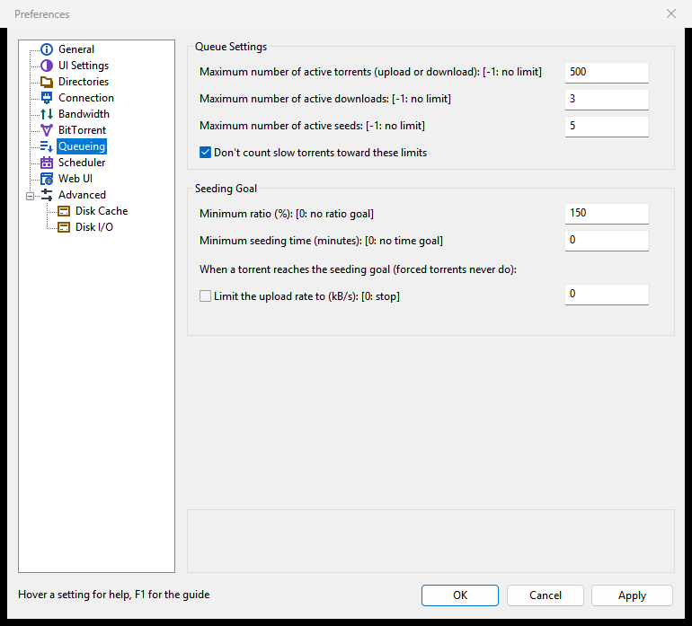
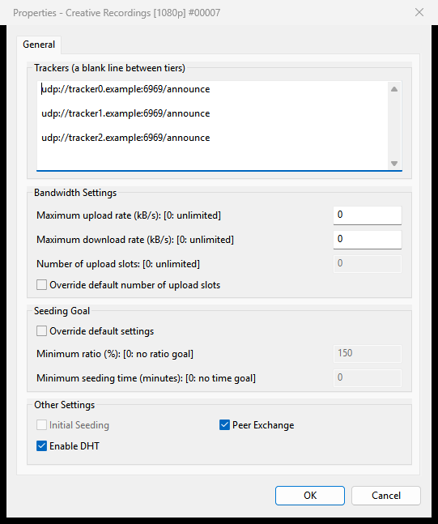

# Queueing and seeding

This page covers how Rookparcel decides which torrents run at once (the queue), what happens when a finished torrent has seeded enough (the seeding goal), initial seeding for new torrents, and moving finished downloads to another folder.

The settings are on **Options > Preferences > Queueing**.

## How the queue works

A torrent you start is handed to the queue. The queue runs as many torrents as its limits allow and lets the rest wait:

| Status | Meaning |
|---|---|
| **Downloading**, **Seeding** | Running, in a slot of the queue. |
| **Queued** | Waiting for a download slot. |
| **Queued Seed** | Finished, waiting for a seeding slot. |
| **[F] Downloading**, **[F] Seeding** | Started with **Force Start**, outside the queue. |
| **Stopped**, **Paused**, **Finished** | Taken out of the queue by you (or, for Finished, by the seeding goal). |

- **Start** hands the selected torrents to the queue.
- **Force Start** runs them now, outside the queue, even when its limits are reached. Forced torrents never reach a seeding goal: they seed until you stop them.
- **Stop** and **Pause** take torrents out of the queue until you start them again.
- **Move Up Queue**, **Move Down Queue**, **Move to Top of Queue** and **Move to Bottom of Queue** in the right-click menu change the order. The **#** column shows each torrent's place. Torrents higher up get a slot first.

See [Managing torrents](Managing-torrents) for these commands and their keys. A new torrent can be added at the top of the queue with **Add to top of queue** in the Add New Torrent window ([Adding torrents](Adding-torrents)).

## Queue settings

Under **Queue Settings**:

| Setting | Meaning | Default |
|---|---|---|
| **Maximum number of active torrents (upload or download): [-1: no limit]** | The most queued torrents running at once, downloads and seeds together. | 500 |
| **Maximum number of active downloads: [-1: no limit]** | The most queued torrents downloading at once. The next one starts when one finishes or stops. | 3 |
| **Maximum number of active seeds: [-1: no limit]** | The most finished queued torrents seeding at once. | 5 |
| **Don't count slow torrents toward these limits** | A torrent moving less than about 2 kB/s for a minute stops taking a download or seed slot, so another can start. It still counts toward the total. | On |

To let everything run at once, set the limits to -1. To download one torrent at a time, set **Maximum number of active downloads** to 1.

"Slow" is set on the Advanced page: `inactive_down_rate` and `inactive_up_rate` (bytes per second, default 2048) and `auto_manage_startup` (seconds a torrent must stay below them, default 60).

## Seeding goal

The seeding goal decides when a finished torrent has seeded enough. Under **Seeding Goal**:

| Setting | Meaning | Default |
|---|---|---|
| **Minimum ratio (%): [0: no ratio goal]** | Upload this percentage of what the torrent downloaded. 150 means one and a half times. | 150 |
| **Minimum seeding time (minutes): [0: no time goal]** | Seed for at least this many minutes. | 0 |

With both set, both must be reached. With both at 0, there is no goal and torrents seed until you stop them.

**When a torrent reaches the seeding goal (forced torrents never do):**

- By default it is stopped. It leaves the queue and shows as **Finished**.
- Tick **Limit the upload rate to (kB/s): [0: stop]** and enter a rate to keep it seeding slowly instead: its own upload limit is set to that rate. With 0, it is stopped anyway. A lower limit the torrent already has stays.

The **Logger** tab writes "seeding goal reached, stopped" or "seeding goal reached, upload limited to ..." with the torrent's name.

Only queued torrents are checked: a force-started, stopped, checking or still-downloading torrent is left alone.

### A goal for one torrent

1. Select the torrent and choose **Properties** (<kbd>Enter</kbd>).
2. Under **Seeding Goal**, tick **Override default settings**.
3. Set **Minimum ratio (%): [0: no ratio goal]** and **Minimum seeding time (minutes): [0: no time goal]**. Both 0 makes this torrent seed for ever.
4. Click **OK**.

## Initial seeding

Initial seeding (super-seeding) helps you spread a torrent you have just created, when you are its only seed: each peer gets pieces no one else has yet, so the swarm gets a full copy sooner.

- Right-click a seeding torrent and choose **Advanced > Initial Seeding**. The item is grey unless every selected torrent is seeding; choose it again to turn it off.
- Or tick **Initial Seeding** under **Other Settings** in the torrent's Properties.

While it is on, the status shows **[S] Seeding**. See [Creating torrents](Creating-torrents) for making a torrent to seed. For rookparcel-nox, `--super-seed` does the same for complete torrents.

## Moving completed downloads

Rookparcel can move a torrent's files to another folder when it finishes downloading, for example from a fast disk to a big one. It keeps seeding from the new place. Set it on **Options > Preferences > Directories**, under **Location of Downloaded Files**:

1. Tick **Move completed downloads to:** and choose the folder below it.
2. Optionally tick **Append the torrent's label**: a torrent with a label goes into a folder named after the label, inside that folder. The label it has when it finishes counts.
3. Leave **Only move from the default download directory** ticked to move only torrents saved in the folder for new downloads (**Put new downloads in:**); torrents you saved elsewhere then stay where they are. Untick it to move every finished torrent.
4. Click **OK**.

It applies to torrents that finish from now on. More on folders and moving files: [Disk and storage](Disk-and-storage#moving-completed-downloads).

## Auto Shutdown and seeding

**Options > Auto Shutdown > ... When Everything Completes** waits for every seed to stop. A seed with no seeding goal, or a forced one, seeds on and holds it back. See [Auto Shutdown](Auto-shutdown).

## In the GTK window and the Web UI

- **GTK window**: the same Queueing page, Properties and menus.
- **Web UI**: the same Queueing page. Its seeding goal box reads **Limit the upload rate instead of stopping the torrent**, with the rate beside it; 0 stops the torrent anyway. The torrent menu has the same queue and Initial Seeding items.
- **rookparcel-nox**: the queue limits and the seeding goal are set in its Web UI's Preferences. `--move-on-complete DIR` moves each torrent that finishes into a folder.

## Related pages

- [Managing torrents](Managing-torrents)
- [Speed limits and the scheduler](Speed-limits-and-scheduler)
- [Disk and storage](Disk-and-storage)
- [Preferences reference](Preferences-reference)
