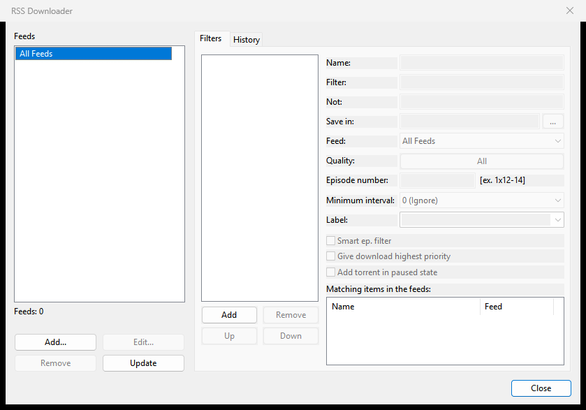

# RSS Downloader

This page explains how to follow RSS feeds in Rookparcel and download from them: adding feeds, downloading items by hand, filters that download matching items automatically, episode and quality matching, and the history. It covers the Windows window first, then the GTK window (Linux, BSD) and the Web UI.

The RSS Downloader works like µTorrent 2.2.1's. Many torrent sites and trackers publish a feed of their new releases; Rookparcel checks your feeds every 15 minutes and adds what your filters ask for.

## Opening the RSS Downloader

- **Options > RSS Downloader...**
- The **RSS Downloader** button on the toolbar.
- Right-click **Feeds** (or a feed) in the category list on the left, then **RSS Downloader...**.



The window has the **Feeds** list on the left, with **Add...**, **Edit...**, **Remove** and **Update** under it, and two tabs on the right: **Filters** and **History**. Changes take effect at once; there is no OK or Cancel, only **Close**. When you close the window, the filters are run over the feeds' current items, so a new filter can download straight away.

## Adding a feed

1. In the RSS Downloader, click **Add...** under **Feeds**. (Or right-click **Feeds** in the main window's category list and choose **Add RSS Feed...**.)
2. **Feed URL:** the feed's address. If a feed address is on the clipboard, it is filled in for you.
3. **Custom Alias:** a name for the feed. Left empty, the feed's own title is shown.
4. Under **Subscription**, choose one:
   - **Do not automatically download all items** (the usual choice): only your filters, or you, download from this feed.
   - **Automatically download all items published in feed**: every new item is downloaded. **Use smart episode filter** under it downloads each episode only once (see [Smart episode filter](#smart-episode-filter)).
5. Click **OK**. The feed is fetched at once.

With **Automatically download all items published in feed** chosen, your filters are not used for that feed: everything new is taken.

**Feeds that need a login.** Some private trackers' feeds need the cookies of your login. Add them to the URL the way µTorrent did, after `:COOKIE:`:

```
https://tracker.example/rss.php:COOKIE:uid=12345;pass=abcdef
```

The cookies are sent only to the feed's own site (the same host or one of its subdomains), and never from an `https` feed to a plain `http` link.

## Managing feeds

The **Feeds** list starts with **All Feeds**, then each feed. Under the list, a line shows the selected feed's state: "Updated" with the time and the number of items, "Not updated yet", "Disabled", or "Error:" and the reason. With **All Feeds** selected it shows how many feeds you have.

| Button or menu entry | What it does |
|---|---|
| **Edit...** / **Edit Feed...** | Changes the URL, alias or subscription. A new URL is a new feed: its old items are dropped and it is fetched again. |
| **Remove** / **Delete Feed** | Removes the feed, after asking. Filters set to that feed stay, and match nothing until you point them at another feed. |
| **Update** / **Update Feed** | Fetches the selected feed now (with **All Feeds** selected, every feed). |
| **Disable Feed** / **Enable Feed** | Stops or resumes checking the feed, without removing it. In the right-click menu only. |

Right-click a feed in the RSS Downloader's Feeds list, or in the main window's category list, for the same entries.

Feeds are checked every 15 minutes. Feed downloads and the `.torrent` files they point to go through the proxy set in Preferences, if you set one.

## Downloading items by hand

The main window's category list has a **Feeds** branch with each feed under it. Click a feed (or **Feeds** for all of them) and the torrent list shows the feed's items instead of your torrents, with the columns **Name**, **Episode**, **Format**, **Date**, **Feed** and **URL**.

- **Episode** shows what Rookparcel read from the title: `1x02`, a range such as `1x02-03`, an absolute number such as `12` (anime), or an air date such as `2026-10-19`.
- **Format** shows the qualities named in the title, such as `720p` or `HDTV`.

To download an item, double-click it, or right-click it and choose **Download**. You can select several items first. An item you download by hand gets the feed's name as its label and goes into the History, as a filter's download would.

## Filters

A filter downloads the items whose titles match it, from one feed or from all of them. Open the **Filters** tab and click **Add**. A filter called "New filter" appears in the list, ticked. Then fill in its fields:

| Field | What it does |
|---|---|
| **Name:** | The filter's name in the list. The list's check box switches the filter on or off. |
| **Filter:** | What the title must match. See [Writing a Filter](#writing-a-filter). Empty matches nothing; `*` matches everything. |
| **Not:** | Titles that match this are skipped, even when **Filter** matches. Same syntax. Empty skips nothing. |
| **Save in:** | The folder for the downloads. Empty uses the default download folder. The **...** button picks a folder. |
| **Feed:** | **All Feeds**, or one feed. |
| **Quality:** | Click the button and tick the qualities you accept. **All** accepts any title, including titles that name no quality. |
| **Episode number:** | Which episodes to take, for example `1x12-14`. Empty takes any. See [Episode numbers](#episode-numbers). |
| **Minimum interval:** | After the filter downloads something, it downloads nothing more until this much time has passed. **0 (Ignore)** means no wait. Choices from 2 hours to 1 month. |
| **Label:** | The label the downloads get. Empty uses the feed's name. See [Managing torrents](Managing-torrents) for labels. |
| **Smart ep. filter** | Downloads each episode only once, whatever its quality or release group. See below. |
| **Give download highest priority** | Puts the download at the top of the queue. |
| **Add torrent in paused state** | Adds the download without starting it. |

Under the fields, **Matching items in the feeds:** lists the items of the feeds' last check that the filter matches on Filter, Not, Feed, Quality and Episode number. Use it to test a filter before you close the window. (Minimum interval and the smart episode filter depend on what was downloaded before, so the list does not apply them.)

**Remove** deletes the selected filter. **Up** and **Down** move it in the list. Order matters: an item goes to the first filter that takes it, so put the more specific filters above the general ones.

Filters run when a feed is checked, and when you close the RSS Downloader. In each feed, the oldest items are looked at first, so with the smart episode filter or a minimum interval the first release of an episode wins. An item is never downloaded twice from the same feed.

### Writing a Filter

The **Filter** and **Not** fields use simple wildcards:

| You type | Meaning |
|---|---|
| `*` | Any run of characters, including none. |
| `?` | Exactly one character. |
| `\|` | Separates alternatives: `show one\|show two` matches either. |

- Case does not matter.
- A `.` or `_` in a title counts as a space, so `the show` matches `The.Show.S01E02.720p`.
- An alternative **without** wildcards matches anywhere in the title: `show` matches `The.Show.S01E02`.
- An alternative **with** wildcards must match the whole title: `show*` does not match `The.Show.S01E02`, but `*show*` does.

Examples:

| Filter | Not | Takes |
|---|---|---|
| `the show` | | every title containing "the show" |
| `*the show*1080p*` | | that show in 1080p only |
| `the show` | `*german*\|*sample*` | that show, but no German releases and no samples |

### Episode numbers

The **Episode number** field takes one or more ranges, separated by `,` or `;`:

| You type | Takes |
|---|---|
| `1x12` or `S01E12` | That one episode. |
| `1x12-14` or `S01E12-S01E14` | Episodes 12 to 14 of season 1. |
| `S01E01-10` | Episodes 1 to 10 of season 1 (the season can be left out after the dash). |
| `S02` | All of season 2. |
| `S01E05-` | Season 1 episode 5 and everything after it. |
| `12` | Episode 12 in any season, for shows numbered straight through, such as anime. |
| `1-12`, `100-` | Episodes 1 to 12; episode 100 and later. |
| `2026.10.19` | The episode that aired on that date (for daily shows). |

Rookparcel reads episodes from titles written as `S01E02` (also `S01E02E03`, `S01E02-E03`), `1x02`, an air date (`2026.10.19`, `2026-10-19`), or an absolute number (`Show - 12`, `Episode 12`). A season pack such as `Show.S01.Complete` names no episode, so a filter with an episode number does not take it. A field Rookparcel cannot read matches nothing.

### Qualities

The **Quality** list: HDTV, TVRip, DVDRip, SVCD, DSRip, DVBRip, PDTV, HR.HDTV, HR.PDTV, DVDR, DVDScr, 720p, 1080i, 1080p, WebRip, SatRip, WEB-DL, BluRay, 480p, 2160p. A title matches when it names one of the qualities you ticked.

### Smart episode filter

With **Smart ep. filter** ticked, the filter remembers the episodes it has downloaded and skips later releases of the same episode, whatever their quality or release group. This is useful when a feed carries the same episode several times.

- A title with no episode in it is always let through.
- A release marked REPACK, PROPER, RERIP or REAL of an episode already downloaded is let through once, since it fixes the earlier release.

The feed subscription's **Use smart episode filter** works the same way for a feed set to download everything.

## History

The **History** tab lists what the RSS Downloader added, newest first, with **Name**, **Date** and **Feed**. It keeps the last 1,000 entries. **Clear History** empties the list; it does not make those items download again.

The Logger tab of the main window also shows a line for each download ("RSS:" with the feed's name and the title) and for each feed error. A download that could not be fetched is tried again at the next check of its feed.

## GTK

The GTK window has the same RSS Downloader, opened from **Options > RSS Downloader...**, the toolbar's **RSS Downloader** button, or the right-click menu of **Feeds** in the sidebar. The fields, buttons and tabs are the same as above. The sidebar's **Feeds** branch shows a feed's items in the list, and **Download** in an item's right-click menu (or a double-click) downloads it. The Add RSS Feed window also offers a feed address from the clipboard.

## Web UI

The Web UI has the RSS Downloader too. Open it with the toolbar's **RSS** button (on a phone, the toolbar's **More** menu, **RSS Downloader...**), or click a feed under **Feeds** in the category list, which opens it on that feed's items.

The page's RSS Downloader has three tabs instead of two:

- **Items**: the selected feed's items (or all feeds'), with **Download** for the selected ones.
- **Filters** and **History**: as above.

Differences:

- **Save in** is a folder on the server, not on the computer with the browser. The **...** button asks for a path; empty means the server's default download folder.
- Which Web UI you use decides whose feeds you edit:
  - **`rookparcel-nox`** keeps its own feeds and filters (in `rss.dat` beside `webui.json`) and runs them on the server, with no window open. It runs the RSS Downloader only while its Web UI is on. See [Running rookparcel-nox](Running-rookparcel-nox).
  - **The Web UI a Windows window hosts** edits that window's own feeds and filters: there is one RSS Downloader, shown in both places. See [Web UI](Web-UI).
- The Web UI also answers the RSS part of qBittorrent's Web API, so a qBittorrent remote app can list feeds and set rules. Its rules use the wildcard syntax above; the regular-expression option is ignored, and feed folders are not supported.

## Remote windows

A window connected to another Rookparcel (File > Connect to Remote, see [Remote control](Remote-control)) has its own feeds and filters, kept on this computer. They are checked from this computer, and what they download is added to the remote server.

## Where feeds are stored

The feeds, filters and history are in `rss.dat` in your settings folder, beside `rookparcel.ini` (for a remote window, in its own `remote\<host>_<port>` folder there). See [Where Rookparcel keeps its files](Where-Rookparcel-keeps-its-files).

For one-off searches instead of feeds, see [Searching for torrents](Searching-for-torrents). For Sonarr and Radarr, which do their own feed checking, see [Sonarr, Radarr and Prowlarr](Sonarr-Radarr-and-Prowlarr).
