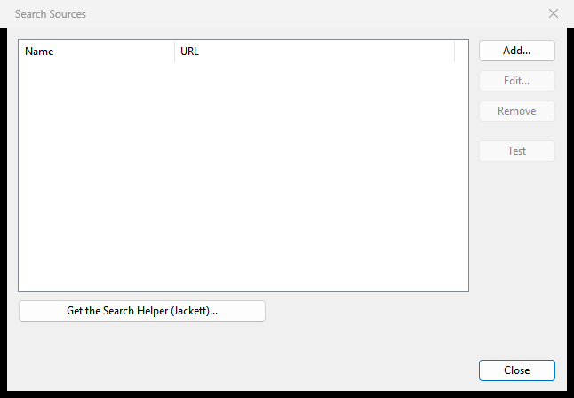

# Searching for torrents

This page explains how to find new torrents from inside Rookparcel: the difference between filtering your own list and searching, how to add search sources (the search helper, or your own Prowlarr or Jackett), and how to add what a search finds. It covers the Windows window, the GTK window (Linux, BSD) and the Web UI.

For a step-by-step walk through the Windows version with screenshots, see [Searching for torrents on Windows](Searching-for-torrents-on-Windows).

## How search works

Rookparcel has no search engine of its own and does not scrape sites itself. It asks a *search source*: a program that knows how to search torrent sites and answers in a standard format called Torznab. Two free programs do this:

- **Jackett** and **Prowlarr**, which you may already run for Sonarr or Radarr, on this computer, a NAS or a server.
- The **search helper**, which is Jackett downloaded and run for you by Rookparcel. This is the easy way if you have neither.

A search goes to every source you pick at the same time. The answers are merged, duplicates (the same torrent from two sources) are shown once, and the list is sorted by seeds.

*The search box and Manage Sources are in the 1.1.40 release. The search helper is new in 1.1.59; not in a published release yet.*

## Filtering your list versus searching

The search box at the top right of the main window has two jobs:

| Mode | What Enter does |
|---|---|
| Filter (the default) | Typing narrows your own torrent list to the names that contain the text. Nothing is searched online. |
| A source, or **All sources** | Typing does not filter the list. Enter sends the text to the chosen source (or every source) and opens the **Search Torrents** window with the results. |

<kbd>Ctrl</kbd>+<kbd>F</kbd> puts the cursor in the box in both GUIs. The grey hint in the empty box says which mode it is in.

### Windows

The small arrow beside the box opens a menu (<kbd>Alt</kbd>+<kbd>Down</kbd> in the box opens it too):

- **Filter torrents**: the list filter. The hint reads "Search torrent names".
- Each search source that is switched on, by name. The hint reads "Search" and the source's name.
- **All sources**. The hint reads "Search all sources".
- **Manage Sources...**, which opens the Search Sources window.

The choice is remembered between starts. If the chosen source is removed or switched off, the box goes back to **Filter torrents**.

### GTK

The menu button beside the box has the same entries, except that the filter entry is called **Search torrent names**. With a source chosen, the hint changes to "Search with Prowlarr or Jackett".

### Web UI

The Web UI's search box only filters the list. Searching has its own button, **Find**, beside it (on a phone, in the toolbar's **More** menu, as **Search Torrents**). Find opens the Search Torrents window with the text of the filter box already in it.

## Manage Sources

Sources are kept in the **Search Sources** window:

- Windows: the arrow beside the search box, then **Manage Sources...**.
- GTK: the menu button beside the search box, then **Manage Sources...**, or the **Manage Sources...** button in the Search Torrents window.
- Web UI: **Find**, then **Manage Sources...** in the Search Torrents window.

The window lists your sources with a check box each. A ticked source is searched when you search **All sources**; an unticked one is kept but left out. The buttons:

| Button | What it does |
|---|---|
| **Add...** | Adds a source of your own (see below). |
| **Edit...** | Changes the selected source's name, URL, API key or check box. |
| **Remove** | Removes the selected source, after asking. |
| **Test** | Asks the source for its list of categories. "OK" and a number of categories means the URL and API key work; otherwise the line under the list shows the error. |

In the Windows and GTK windows the search helper's buttons are here too; see [The search helper](#the-search-helper).

While you have no sources, a search shows "No search sources yet: add your Prowlarr or Jackett under Manage Sources."

## Adding your own Prowlarr or Jackett

If you run Prowlarr or Jackett already, add it as a source:

1. Open **Search Sources** and click **Add...**. The **Add Search Source** window opens.
2. **Name:** anything you like. Left empty, the source is shown by its host name.
3. **Torznab URL:** the address of the source's Torznab feed:
   - Jackett: `http://host:9117/api/v2.0/indexers/all/results/torznab/`. The `all` part searches every indexer you set up in Jackett, so one source is enough.
   - Prowlarr: `http://host:9696/1/api`, where `1` is the indexer's number. Prowlarr has no "all indexers" feed, so add one source per indexer.

   Replace `host` with `localhost` when it runs on the same computer, or with the computer's address on your network.
4. **API key:** the key from Jackett's page, or from Prowlarr's **Settings > General**.
5. Leave **Search this source** ticked, and click **OK**.
6. Select the new source and click **Test**. It should say "OK" and a number of categories.

The URL must start with `http://` or `https://`.

**The API key** is stored encrypted (on Windows) and never shown again. When you edit a source, the key box starts empty with the grey hint "Unchanged"; leave it empty to keep the stored key, or type a new one. The key is taken out of any address shown in an error or a status line.

**Proxy.** A source on this computer or your local network is always reached directly. A source on a public address goes through the proxy set in Preferences, if you set one. See [Connection, ports and firewall](Connection-ports-and-firewall).

### In the Web UI

The Web UI's Add and Edit windows have one more field, **Current Web UI password:**. Adding a source, or changing a source's URL or API key, needs the current Web UI password. Renaming a source, ticking it on or off, removing it, testing it and searching do not. A wrong password signs you out, as it does elsewhere in the Web UI.

The Web UI never shows a stored API key, and never sends the result links (which carry the indexer's key) to the browser.

## The search helper

The search helper is [Jackett](https://github.com/Jackett/Jackett), a separate free program by its own authors under the GPL-2.0 licence. Rookparcel downloads Jackett's own release from GitHub when you click the button, checks it against the checksum GitHub publishes, keeps it in a `search-helper` folder in your profile, and runs it only while you search. Nothing is downloaded or run before you click.

*New in 1.1.59; not in a published release yet.*

### Where it is offered

| Where | Search helper |
|---|---|
| Windows window (x64 and ARM64) | Yes |
| GTK window on Linux (x86-64 and ARM64) | Yes |
| macOS app (Intel and Apple silicon) | Yes |
| Flatpak | No |
| FreeBSD | No (Jackett has no build for it) |
| Builds made by a package manager with the update check left out | No |
| Web UI and `rookparcel-nox` | No buttons for it |

Where it is not offered, the Search Sources window has no helper buttons, and **Add...** for your own Prowlarr or Jackett still works.

### Getting it

1. Open **Search Sources** and click **Get the Search Helper (Jackett)...**.
2. Rookparcel looks up the newest Jackett release and asks before downloading. The question names the version, the size (about 50 MB) and the folder it goes into. Click **Yes**.
3. A progress window shows the download. Rookparcel then checks the file, unpacks it and starts it once to read its list of sites.
4. The **Search Helper Sites** window opens. Nothing is ticked for you. Tick the public sites you want to search and click **OK**. Sites marked "Needs FlareSolverr, which the helper does not include" are greyed and cannot be ticked.
5. Back in Search Sources, the helper is listed as **Search helper (all)**. The line at the bottom says how many sites are ticked.

Then choose **Search helper (all)** (or **All sources**) in the search box's menu and search.

Two or three sites are enough to start. Every ticked site is asked on every search, so more sites make searches slower and add duplicates.

Once the helper is installed, the **Get** button is replaced by four others:

| Button | What it does |
|---|---|
| **Pick Sites...** | Opens the Search Helper Sites window again, to tick or untick sites. |
| **Open the Helper's Page** | Opens Jackett's own page in your browser and copies its password to the clipboard (the page asks for it). Use it to add private sites with your login; they are then searched along with the ticked ones. |
| **Update the Search Helper** | Looks for a newer Jackett and asks before downloading it. Your sites and settings stay. Nothing updates on its own. |
| **Remove the Search Helper** | Asks, then stops the helper, deletes its folder and takes its source out of the list. |

### How it runs

- It starts at your first search of its source and stops by itself ten minutes after the last one. It also stops when Rookparcel closes. It never starts on its own or at boot.
- It listens only on this computer (`127.0.0.1`), never on your network.
- It needs no administrator rights.
- If you set a proxy in Preferences, the helper uses it for the sites. "Use only this network" does not bind the helper, because it is a separate program: its requests take the computer's normal route.

### Where it lives

The `search-helper` folder in your profile's folder:

| System | Folder |
|---|---|
| Windows | `%APPDATA%\Rookparcel\search-helper`; in portable mode, the folder with `rookparcel.exe`; with a profile, that profile's folder |
| Linux (GTK) | `~/.local/share/rookparcel/gtk/search-helper` (with a profile, under `profiles/<name>/`) |
| macOS | `~/Library/Application Support/Rookparcel/mac/search-helper` (with a profile, under `profiles/<name>/`) |

Each profile has its own helper. See [Where Rookparcel keeps its files](Where-Rookparcel-keeps-its-files) and [Profiles](Profiles).

## The Search Torrents window

The window opens when you press Enter in the search box with a source chosen (Windows, GTK), or when you click **Find** (Web UI). It has:

- **The query** and **Search**, to search again from the window.
- **A category**: **All categories**, **Movies**, **Audio**, **PC**, **TV**, **Books** or **Other**.
- **A source**: **All sources**, or one source.
- **Stop**, to stop the sources still searching. The results so far stay.
- **One status line per source**: "searching...", the number of results, or the error. One source failing does not stop the others.
- **The results**, with the columns **Name**, **Size**, **Seeds**, **Peers**, **Category**, **Age** and **Source**. Click a column header to sort; the list starts sorted by seeds. When two sources find the same torrent it is listed once, and **Source** names both.
- The number of results, **Add** and **Close**.

On a phone, the Web UI's results show Name, Size and Seeds only.

Closing the window stops the search (Windows: <kbd>Esc</kbd> closes it too).

## Adding a result

Select a result and click **Add**, double-click it, or press <kbd>Enter</kbd> in the list.

Rookparcel fetches the result from its source (a `.torrent` file or a magnet link) and adds it the same way an opened `.torrent` file or a clicked magnet link is added. If **Show a window that displays the files inside the torrent** is on in **Options > Preferences > UI Settings**, the Add New Torrent window opens first. See [Adding torrents](Adding-torrents).

The line at the bottom says "Added:" and the torrent's name. The GTK window and the Web UI refuse a result that is already in your torrent list.

In the Web UI the torrent is added on the server.

## Searching from a remote window or the Web UI

- **A remote window** (File > Connect to Remote, see [Remote control](Remote-control)) searches from this computer, with its own list of sources, and adds what you pick to the remote server.
- **The Web UI of `rookparcel-nox`** keeps its own sources on the server. Searches and downloads run on the server; every open page sees the same search.
- **The Web UI a Windows window hosts** uses that window's sources: a source added in the window shows on the page and the other way round. See [Web UI](Web-UI).

The Web UI also answers the search part of qBittorrent's Web API, so the search tab of a qBittorrent remote app searches your sources too.

## If something goes wrong

| What you see | What it means |
|---|---|
| The results window never opens | The box is in filter mode. Choose a source or **All sources** in its menu first. |
| "No search sources yet: ..." | Add a source in Manage Sources, or get the search helper. |
| A source's line shows an error | That source failed; the others still answer. Click **Test** in Search Sources to check its URL and API key. |
| Test shows `HTTP 401` or an error about the API key | The API key is wrong. Edit the source and type the key again. |
| The search helper finds nothing | No sites are ticked, or the ticked sites are down or changed. **Pick Sites...** shows what is ticked; try another site. |
| "Could not get the search helper: ..." | GitHub could not be reached or the download was interrupted. Try again. |
| "The search helper did not start: ..." | The program in the `search-helper` folder could not run: a damaged download, or an antivirus that removed files. Remove and get it again. |

More help: [Troubleshooting and FAQ](Troubleshooting-and-FAQ). For automatic downloads of new episodes from feeds, see [RSS Downloader](RSS-Downloader). To use Rookparcel as Prowlarr's download client, see [Sonarr, Radarr and Prowlarr](Sonarr-Radarr-and-Prowlarr).
