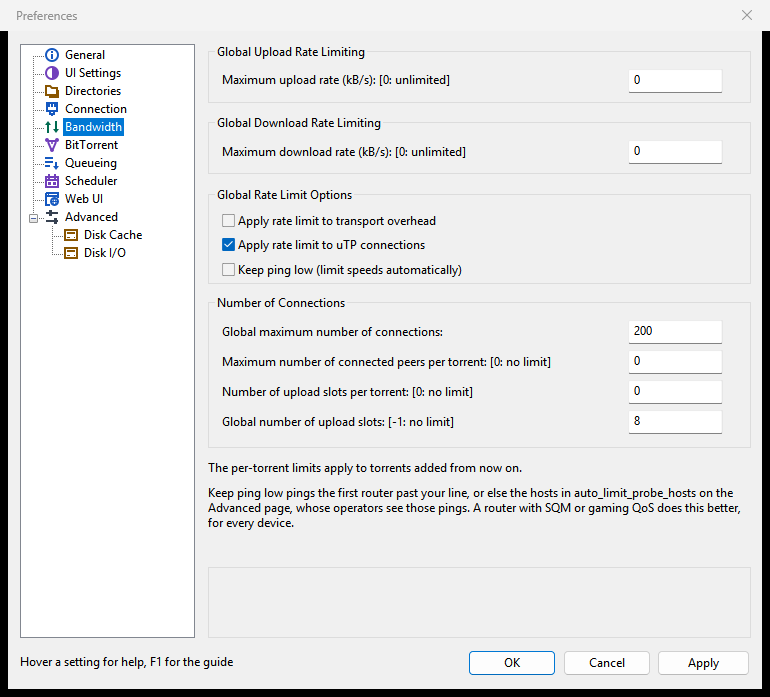
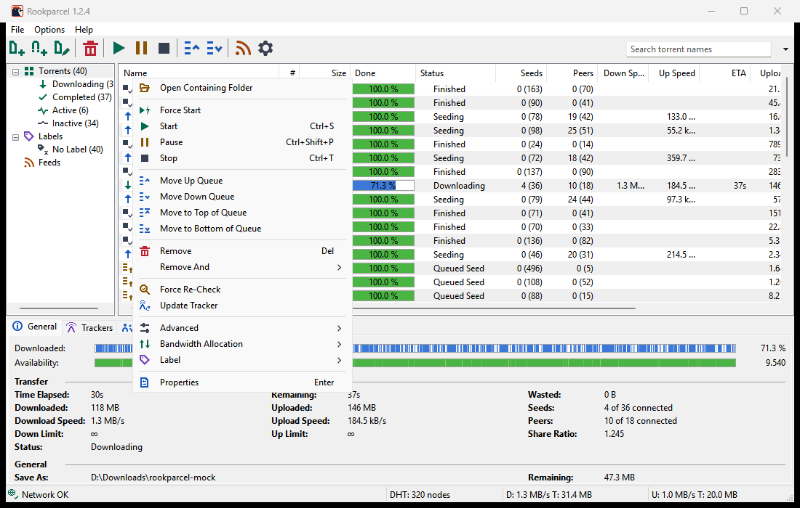
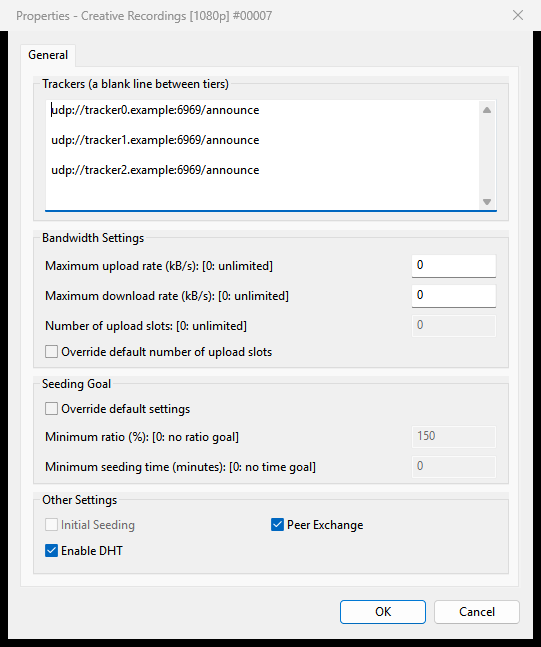
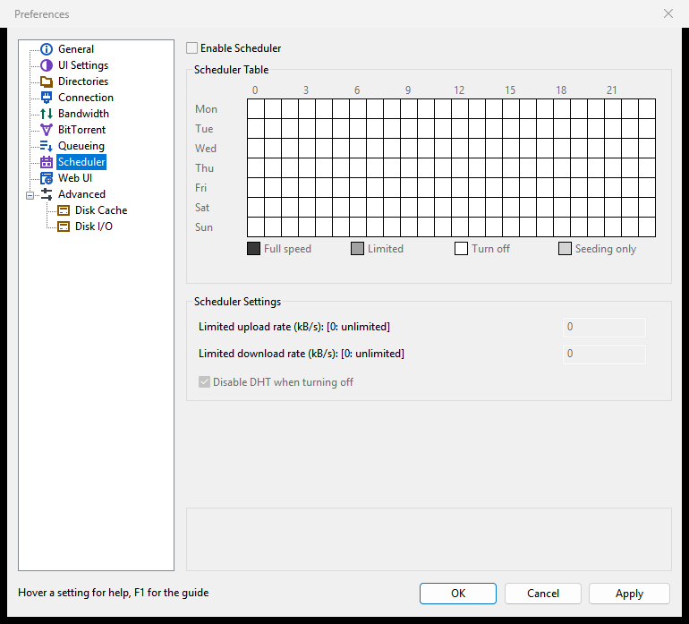

# Speed limits and the scheduler

This page covers how to cap Rookparcel's download and upload speeds: for all torrents together, for single torrents, and by the hour with the weekly scheduler. For limits that follow your line's ping by themselves, see [Keep ping low](Keep-ping-low).

All rates are in kB/s, where 1 kB is 1024 bytes. In every rate box, 0 means unlimited.

## Global limits

The global limits cap all torrents together.

1. Open **Options > Preferences** (<kbd>Ctrl</kbd>+<kbd>P</kbd>) and choose **Bandwidth**.
2. Under **Global Upload Rate Limiting**, set **Maximum upload rate (kB/s): [0: unlimited]**.
3. Under **Global Download Rate Limiting**, set **Maximum download rate (kB/s): [0: unlimited]**.
4. Click **OK** or **Apply**. The new limits apply at once.

Both are unlimited by default. A limited upload is the usual reason to set one: when Rookparcel uploads as fast as the line allows, web pages, games and calls slow down for everyone in the house.

### Global Rate Limit Options

The same page has three boxes that change what the limits count:

| Option | What it does | Default |
|---|---|---|
| **Apply rate limit to transport overhead** | Counts the TCP/IP headers of peer traffic, estimated per packet, against the global limits, so the limits match what the line carries. | Off |
| **Apply rate limit to uTP connections** | Applies the global limits to uTP peers too. Off, uTP peers are slowed only by uTP's own delay control, which gives way to other traffic. | On |
| **Keep ping low (limit speeds automatically)** | Caps uploads and downloads automatically while the delay on your line grows. See [Keep ping low](Keep-ping-low). | Off |

### Connections and upload slots

The **Number of Connections** group on the same page is not a speed limit, but it affects speed:

| Setting | Meaning | Default |
|---|---|---|
| **Global maximum number of connections:** | The most peer connections open at once across all torrents. Lower it if the router struggles. | 200 |
| **Maximum number of connected peers per torrent: [0: no limit]** | The most peers one torrent connects to. | 0 |
| **Number of upload slots per torrent: [0: no limit]** | How many peers one torrent uploads to at once. | 0 |
| **Global number of upload slots: [-1: no limit]** | How many peers all torrents together upload to at once, the fastest ones chosen. Fewer slots give each peer more speed. | 8 |

The two per-torrent values apply to torrents added from now on; a torrent's Properties can change its own upload slots. The Setup Guide's router question can lower the connection numbers for an older router: see [First start and the Setup Guide](First-start-and-the-Setup-Guide).

## Limits for single torrents

A torrent can have limits of its own, below the global ones. The global limits still apply on top.

**From the right-click menu:**

1. Select one or more torrents in the list.
2. Right-click and choose **Bandwidth Allocation > Set Download Limit** or **Bandwidth Allocation > Set Upload Limit**.
3. Pick a rate: **Unlimited**, or one of 10, 25, 50, 100, 250, 500, 1000, 2500 and 5000 kB/s.

The first selected torrent's current rate is ticked.

**From Torrent Properties**, for any rate:

1. Select the torrents and choose **Properties** (<kbd>Enter</kbd>).
2. Under **Bandwidth Settings**, set **Maximum upload rate (kB/s): [0: unlimited]** and **Maximum download rate (kB/s): [0: unlimited]**.
3. To give the torrent its own number of upload slots, tick **Override default number of upload slots** and fill in **Number of upload slots: [0: unlimited]**.
4. Click **OK**.

A torrent's own limits show in the **Down Limit** and **Up Limit** columns of the torrent list and on the **General** tab. See [Torrent details and files](Torrent-details-and-files) for the rest of the Properties dialog.

A torrent that reaches its seeding goal can also get an upload limit by itself: see [Queueing and seeding](Queueing-and-seeding#seeding-goal).

## The status bar

The status bar at the bottom of the main window shows the current rates and the totals of this session, as **D: 1.2 MB/s T: 3.4 GB** for download and **U: ... T: ...** for upload. While Keep ping low or the busy-disk slow-down holds a direction back, its part shows the automatic cap too, as **U: 412.0 kB/s (auto 450.0 kB/s) T: ...**.

The status bar has no speed menu. Set the global limits in Preferences, or the torrents' own limits from their menu.

With **Show current speed in the title bar** on (**Options > Preferences > UI Settings**), the window's title and taskbar button start with the speeds too.

## The scheduler

The scheduler follows a weekly table, hour by hour, and switches Rookparcel between four modes. It is off by default.

1. Open **Options > Preferences > Scheduler**.
2. Tick **Enable Scheduler**. The table is grey until you do.
3. Click a cell in the **Scheduler Table** to move that hour to the next mode. Hold the button and drag to paint the cells you pass over with the same mode.
4. Under **Scheduler Settings**, set the rates for the **Limited** hours.
5. Click **OK** or **Apply**.

The table has one row per day, Monday first, and one column per hour, in your computer's local time. A click cycles **Full speed**, **Limited**, **Turn off** and **Seeding only**. The line under the table names the hour under the pointer and its mode, such as "Mon 09:00 - 10:00: Full speed".

| Mode | Colour | What Rookparcel does in that hour |
|---|---|---|
| **Full speed** | dark green | Runs with your normal settings. |
| **Limited** | light green | Uses the two Limited rates below in place of the global limits. |
| **Turn off** | white | Pauses every torrent. With **Disable DHT when turning off**, the DHT is switched off too, so Rookparcel stays quiet on the network. |
| **Seeding only** | light red | Uploads, but downloads nothing. Torrents added during these hours wait too. |

| Scheduler setting | Meaning | Default |
|---|---|---|
| **Limited upload rate (kB/s): [0: unlimited]** | The global upload limit during Limited hours. | 0 |
| **Limited download rate (kB/s): [0: unlimited]** | The global download limit during Limited hours. | 0 |
| **Disable DHT when turning off** | Also switches the DHT off during Turn off hours. | On |

What to expect:

- When the hour changes mode, the status bar's network part adds **Scheduler: limited**, **Scheduler: turned off** or **Scheduler: seeding only**, and the **Logger** tab writes a line such as "Scheduler: Limited". Full speed shows nothing.
- Turn off does not change the torrents' own state. When Full speed comes back they carry on as before, and a torrent you stopped stays stopped.
- Untick **Enable Scheduler** to go back to full speed with your normal settings at once.
- Keep ping low and the busy-disk slow-down can still lower the speeds during any hour; they never raise them.

## Alternative speed limits (Web UI of rookparcel-nox)

The Windows and GTK windows have no alternative speed limits; use the scheduler's Limited hours instead.

[rookparcel-nox](Running-rookparcel-nox)'s Web UI has them, under **Preferences > Bandwidth > Alternative Rate Limits**:

| Setting | Meaning | Default |
|---|---|---|
| **Alternative upload rate (kB/s): [0: unlimited]** | The global upload limit while the alternative limits are on. | 10 |
| **Alternative download rate (kB/s): [0: unlimited]** | The global download limit while they are on. | 10 |
| **Use the alternative rate limits now** | Switches to the alternative limits until you switch back. | Off |

Apps that switch qBittorrent's speed limits mode through the Web UI (see [Sonarr, Radarr and Prowlarr](Sonarr-Radarr-and-Prowlarr)) switch the same thing. The scheduler's Limited hours still win over both sets while they last.

When a desktop window serves the Web UI (Preferences > Web UI in the window), this group is not shown and the alternative limits cannot be switched on: the window's own limits and scheduler apply.

## In the GTK window and the Web UI

- **GTK window** (Linux, BSD, macOS): the same Preferences pages, the same **Bandwidth Allocation** submenu in the torrent menu, the same scheduler table, edited the same way.
- **Web UI**: the same pages under its **Preferences**, and the same **Bandwidth Allocation** submenu. Its status bar shows a global limit in brackets after the rate while one is set, and the automatic cap the same way as the window.
- **rookparcel-nox** without the Web UI: `--dl-limit KIB` and `--ul-limit KIB` set the global limits at start (0 = unlimited). The scheduler, the seeding goal and the alternative limits are set in the Web UI's **Preferences**.

## Related pages

- [Keep ping low](Keep-ping-low)
- [Queueing and seeding](Queueing-and-seeding)
- [Disk and storage](Disk-and-storage#when-the-disk-is-busy)
- [Preferences reference](Preferences-reference)
