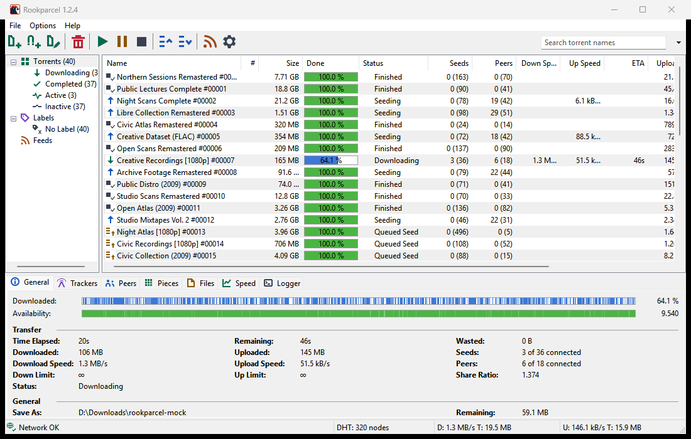

# The main window

This page walks through Rookparcel's main window: the menus, the toolbar and its search box, the category list, the torrent list and its columns, the detail tabs and the status bar. It describes the Windows version first, then what differs in the GTK version and the Web UI.

## The parts at a glance

| Part | Where | What it is for |
|---|---|---|
| Menu bar | top | **File**, **Options** and **Help** |
| Toolbar | under the menus | buttons for the common actions, and the search box at the right |
| Category list | left | shows the torrents by state or by label, and your RSS feeds |
| Torrent list | middle | one row per torrent |
| Detail tabs | under the list | the selected torrent's details: General, Trackers, Peers, Pieces, Files, Speed, Logger |
| Status bar | bottom | the network state, DHT, and the total speeds |

Each part except the menus and the torrent list can be hidden from the **Options** menu: **Show Toolbar**, **Show Detailed Info**, **Show Status Bar** and **Show Category List**. Drag the borders between the category list, the torrent list and the detail tabs to resize them. Rookparcel remembers these choices, the sizes, the columns, the sort order and the open tab.

## The menus

- **File:** **Add Torrent...**, **Add Torrent from URL...**, **Create New Torrent...**, **Import from qBittorrent...**, **Import from µTorrent...**, **Profiles**, **Connect to Remote...** and **Exit**.
- **Options:** **Preferences**, **Setup Guide**, **RSS Downloader...**, the four **Show** items above, **Auto Shutdown**, **Close to Tray** and **Minimize to Tray**.
- **Help:** **Rookparcel Website**, **Check for Updates**, **About Rookparcel** and **Third-Party Notices**.

*File > Profiles is new in 1.1.48 and Options > Setup Guide in 1.1.62; neither is in a published release yet.*

Pages: [Adding torrents](Adding-torrents), [Creating torrents](Creating-torrents), [Importing from µTorrent and qBittorrent](Importing-from-uTorrent-and-qBittorrent), [Profiles](Profiles), [Remote control](Remote-control), [Preferences reference](Preferences-reference), [First start and the Setup Guide](First-start-and-the-Setup-Guide), [RSS Downloader](RSS-Downloader), [Auto Shutdown](Auto-shutdown), [Tray, notifications and startup](Tray-notifications-and-startup), [Updating Rookparcel](Updating-Rookparcel).

## The toolbar

From left to right:

| Button | Does |
|---|---|
| **Add Torrent** | adds `.torrent` files (<kbd>Ctrl</kbd>+<kbd>O</kbd>) |
| **Add Torrent from URL** | adds a magnet link or a web address (<kbd>Ctrl</kbd>+<kbd>U</kbd>) |
| **Create New Torrent** | makes a new `.torrent` (<kbd>Ctrl</kbd>+<kbd>N</kbd>) |
| **Remove** | removes the selected torrents from the list (<kbd>Del</kbd>) |
| **Start**, **Pause**, **Stop** | start, pause or stop the selected torrents |
| **Move Up Queue**, **Move Down Queue** | move the selected torrents one place in the queue |
| **RSS Downloader** | opens the RSS Downloader |
| **Preferences** | opens Preferences (<kbd>Ctrl</kbd>+<kbd>P</kbd>) |

Hover a button to see its name. From 1.1.57 on (not in a published release yet), the status bar also shows a line on what the button under the pointer, or the highlighted menu item, does. What Start, Pause and Stop mean is on [Managing torrents](Managing-torrents#start-pause-stop-and-force-start).

### The search box

The box at the right end of the toolbar does two jobs, chosen with the small arrow beside it:

- **Filter torrents** (the usual mode): as you type, the list shows only torrents whose name contains the text, ignoring case. The filter works on top of the category you picked on the left. <kbd>Esc</kbd> empties the box and returns to the list. <kbd>Ctrl</kbd>+<kbd>F</kbd> puts the cursor in the box.
- **A search source**: <kbd>Enter</kbd> searches the web for torrents through Prowlarr, Jackett or the search helper. See [Searching for torrents](Searching-for-torrents).

The choice is remembered between starts.

## The category list

The list on the left narrows the torrent list. Each entry shows how many torrents it holds.

| Entry | Shows |
|---|---|
| **Torrents** | every torrent |
| **Downloading** | torrents not finished yet |
| **Completed** | finished torrents |
| **Active** | torrents downloading or uploading data right now |
| **Inactive** | torrents moving no data right now |
| **Labels** > **No Label** | torrents without a label |
| **Labels** > *a label* | torrents with that label; one entry per label in use |
| **Feeds** | your RSS feeds; picking one shows its items in the list |

Labels are made and given from the torrent list's right-click menu. See [Managing torrents](Managing-torrents#labels). The Feeds branch has its own right-click menu; see [RSS Downloader](RSS-Downloader).

## The torrent list

One row per torrent. Click a row to select it; <kbd>Ctrl</kbd>+click and <kbd>Shift</kbd>+click select several; <kbd>Ctrl</kbd>+<kbd>A</kbd> selects all. Right-click for the torrent menu, described on [Managing torrents](Managing-torrents#the-right-click-menu).

Double-click a finished torrent to open its folder in Explorer. Double-click a torrent that is not finished, or press <kbd>Enter</kbd>, to open its [Properties](Torrent-details-and-files#torrent-properties).

### Columns

Right-click the column headers to show or hide columns. **Name** is always shown. Drag a header to move the column; drag its edge to change the width.

| Column | Shows | Shown at first |
|---|---|---|
| **Name** | the torrent's name | yes |
| **#** | its place in the queue; `*` when it has none | yes |
| **Size** | the size of the files you chose to download | yes |
| **Done** | how much is downloaded, in percent | yes |
| **Status** | what the torrent is doing (see below) | yes |
| **Seeds** | seeds connected, and in brackets the seeds in the whole swarm when the tracker reports it | yes |
| **Peers** | peers connected, and in brackets the peers in the swarm | yes |
| **Down Speed**, **Up Speed** | current speeds | yes |
| **ETA** | estimated time left | yes |
| **Uploaded** | total uploaded | yes |
| **Downloaded** | total downloaded | no |
| **Ratio** | uploaded divided by downloaded | yes |
| **Avail.** | how many complete copies the connected peers hold together | yes |
| **Label** | its label | yes |
| **Added On**, **Completed On** | dates | no |
| **Tracker** | the host name of the tracker in use | no |
| **Down Limit**, **Up Limit** | its own speed limits | no |
| **Remaining** | what is left to download | no |
| **Seeds/Peers** | seeds per peer in the swarm | no |
| **Save As** | the folder its files are in | no |
| **Wasted** | data thrown away (failed checks, duplicates) | no |

### Sorting

Click a column header to sort by it. The first click sorts the way that is usually most useful: speeds, seeds, peers, ratio and done go from high to low, the others from low to high. Click again to reverse. Names sort the way Explorer does, so "Episode 2" comes before "Episode 10".

### What the Status column says

| Status | Meaning |
|---|---|
| **Downloading**, **Seeding** | running |
| **Queued**, **Queued Seed** | started, but waiting for a free place in the queue |
| **[F] Downloading**, **[F] Seeding** | started with **Force Start**, outside the queue |
| **[S] Seeding** | seeding with **Initial Seeding** on |
| **Paused** | paused by you |
| **Stopped** | stopped by you before it finished |
| **Finished** | stopped after it finished |
| **Downloading metadata** | a magnet link fetching the torrent's file list |
| **Checking 45.3 %**, **Queued for checking** | checking the files on disk |
| **Moving** | moving its files to another folder |
| **Waiting for the network** | **Use only this network** finds no matching network adapter (the VPN is down); it carries on by itself when it is back. *New in 1.1.58; not in a published release yet.* |
| **Error: ...** | something went wrong; the message says what |

See [Managing torrents](Managing-torrents) for the actions behind these states.

## The detail tabs

The tabs under the list show the selected torrent: **General**, **Trackers**, **Peers**, **Pieces** and **Files**. **Speed** and **Logger** are for the whole program. Each tab is described on [Torrent details and files](Torrent-details-and-files).

## The status bar

From left to right:

| Part | Shows |
|---|---|
| Update notice | "Rookparcel ... is available - click here to download it", only when a newer version is out. See [Updating Rookparcel](Updating-Rookparcel). |
| Network | **Network OK** when other peers can connect to you, **No incoming connections** when none has yet. **Port ... in use** means another program, often another Rookparcel profile, holds the listening port; click it to open Preferences > Connection. The scheduler's state follows when it limits the speed, for example "Scheduler: limited". |
| **DHT: ... nodes** | how many DHT nodes Rookparcel knows |
| **D: ... T: ...** | download speed, and total downloaded this session |
| **U: ... T: ...** | upload speed, and total uploaded this session |

With **Keep ping low** holding the speeds down, the speed parts add the automatic limit, for example "D: 400 kB/s (auto 450 kB/s) T: 2.10 GB".

*New in 1.1.58, not in a published release yet:* while **Use only this network** finds no matching adapter, the network part says "Waiting for the network", and hovering it shows your address as trackers see it. The **Port ... in use** text came with profiles in 1.1.45, also after the 1.1.40 release.

See [Connection, ports and firewall](Connection-ports-and-firewall), [Speed limits and scheduler](Speed-limits-and-scheduler) and [Keep ping low](Keep-ping-low).

## The title bar and the tray

With **Show current speed in the title bar** on (Preferences > UI Settings), the window title starts with the download and upload speeds, which also show on the taskbar.

Rookparcel puts an icon in the notification area. Hovering it shows the version and the speeds. A click shows or hides the window; a right-click opens a menu with **Hide Rookparcel** or **Show Rookparcel**, **Add Torrent...**, **Add Torrent from URL...**, **Start All Torrents**, **Stop All Torrents** and **Exit**. By default the close button hides the window to the tray and the torrents keep running; **Exit** quits. See [Tray, notifications and startup](Tray-notifications-and-startup).

## In the GTK version (Linux, BSD)

- The same layout: toolbar, category list, torrent list, detail tabs and status bar. The toolbar has no **Preferences** button; use **Options > Preferences** or <kbd>Ctrl</kbd>+<kbd>P</kbd>.
- The **Options** menu has **Preferences**, **Setup Guide**, **RSS Downloader...** and **Auto Shutdown**. There are no **Show** items and no tray items in it.
- **File > Exit** is also <kbd>Ctrl</kbd>+<kbd>Q</kbd>.
- Right-clicking a column header shows or hides columns; headers can be dragged to reorder them.
- Double-click works as on Windows: a finished torrent opens its folder, another one opens Properties.

## In the Web UI

- The page has a toolbar (**Add Torrent**, **Add URL**, **Remove**, **Start**, **Pause**, **Stop**, **Up**, **Down**, **RSS**, **Preferences** and **Find**), the category list, the torrent list and the same seven detail tabs, plus a search box that filters the list by name.
- Click a header to sort, drag it to reorder, drag its edge to resize. Right-click the headers to show or hide columns; **Reset Columns** goes back to the default.
- On a phone, the category list opens from the ☰ button, and the ⋯ button has the actions that do not fit, **Sort By** and **Sort Descending**.

See [Web UI](Web-UI).

## Related pages

- [Keyboard shortcuts](Keyboard-shortcuts)
- [Managing torrents](Managing-torrents)
- [Torrent details and files](Torrent-details-and-files)
