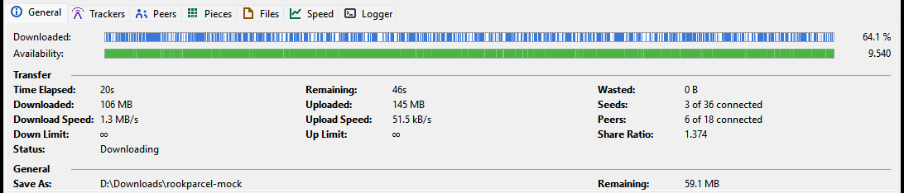
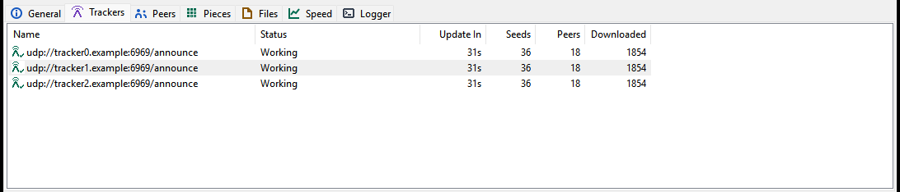
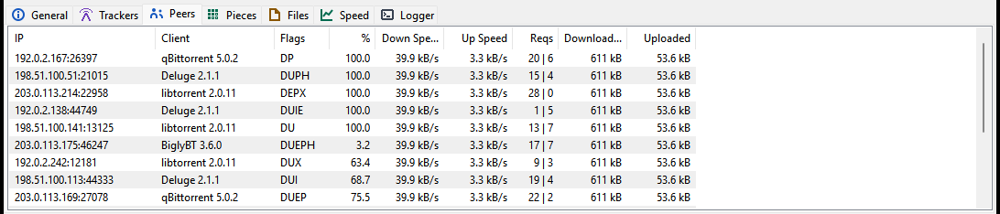
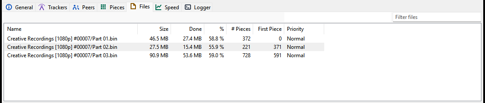
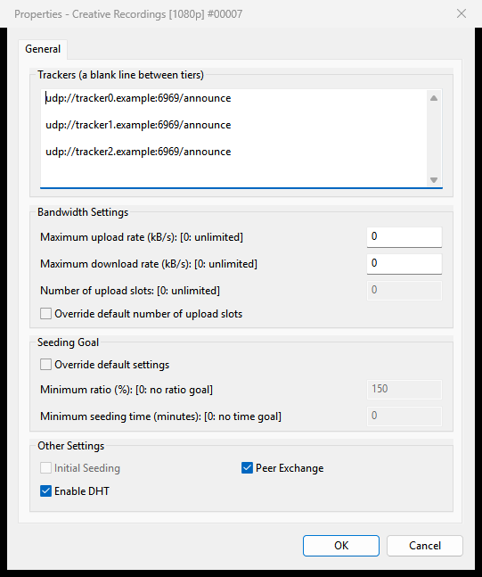

# Torrent details and files

This page explains the detail tabs under the torrent list (General, Trackers, Peers, Pieces, Files, Speed and Logger), how to choose which files to download and in what order, and the Torrent Properties window with a torrent's trackers, limits and seeding goal.

Select a torrent in the list to fill the tabs. **Options > Show Detailed Info** shows or hides them; drag the border above them to change their height. Rookparcel remembers the open tab.

## General

The overview of one torrent.

- **Downloaded:** a bar with one stripe per piece you have, and the percentage done.
- **Availability:** a bar showing which pieces the connected peers have, and how many complete copies they hold together. Below 1, nobody connected has every piece.

**Transfer**

| Field | Meaning |
|---|---|
| **Time Elapsed:** | how long the torrent has been running |
| **Remaining:** | estimated time left |
| **Wasted:** | data thrown away: pieces that failed their check, and duplicates |
| **Downloaded:**, **Uploaded:** | totals for this torrent |
| **Seeds:**, **Peers:** | "3 of 120 connected": connected, and the total the tracker reports |
| **Download Speed:**, **Upload Speed:** | current speeds |
| **Down Limit:**, **Up Limit:** | the torrent's own limits; ∞ for none |
| **Share Ratio:** | uploaded divided by downloaded |
| **Status:** | the same text as the Status column |

**General**

| Field | Meaning |
|---|---|
| **Save As:** | the folder the files are in |
| **Remaining:** | how much is left to download |
| **Total Size:** | the whole torrent, skipped files included |
| **Added On:**, **Completed On:** | dates |
| **Pieces:** | "1200 x 1.00 MB (have 800)": the number of pieces, their size, and how many you have |
| **Hash:** | the torrent's info-hash |
| **Your address as trackers see it:** | your public address, so you can tell whether your VPN is in use. *New in 1.1.58; not in a published release yet.* |

## Trackers

The torrent's trackers, one row each.

| Column | Meaning |
|---|---|
| **Name** | the tracker's address |
| **Status** | **Working**, **Working:** with the tracker's message, **Updating...**, or **Error** / the tracker's error message; empty when it was not contacted yet |
| **Update In** | time until the next announce |
| **Seeds**, **Peers**, **Downloaded** | the swarm's numbers as the tracker reports them |

To contact the trackers now, use **Update Tracker** in the right-click menu. To add, remove or reorder trackers, use [Properties](#torrent-properties).

## Peers

The peers you are connected to. A web seed shows its address in the **IP** column.

| Column | Meaning |
|---|---|
| **IP** | the peer's address |
| **Client** | the peer's BitTorrent program |
| **Flags** | see below |
| **%** | how much of the torrent the peer has |
| **Down Speed**, **Up Speed** | speed from and to this peer |
| **Reqs** | requests waiting, from us and to us |
| **Downloaded**, **Uploaded** | totals with this peer |

The **Flags** are µTorrent's letters:

| Flag | Meaning |
|---|---|
| D / d | you are downloading from the peer / you want to, but it is not sending now |
| U / u | you are uploading to the peer / it wants data, but you are not sending now |
| O | optimistic unchoke: you are giving the peer a chance |
| S | snubbed: the peer has stopped sending |
| I | the peer connected to you |
| E / e | the connection is encrypted / only its handshake is |
| P | the connection uses uTP |
| H | the peer was found through the DHT |
| X | the peer was found through Peer Exchange |
| L | the peer was found on your local network |

## Pieces

A map with one square per piece. Blue squares are pieces you have. Orange ones are being downloaded. The others are shades of green: the darker, the more connected peers have that piece; white means none has it. The line above the map counts the pieces. When there are more than fit, the map ends with "... more".

The list below the map shows the pieces being downloaded now: their number (**#**), **Size**, **# of Blocks**, a **Blocks** bar, and how many blocks are **Completed**. In the bar, blue blocks are on disk, green ones are being written, orange ones are requested from a peer, white ones are still free.

## Files

The torrent's files, one row each.

| Column | Meaning |
|---|---|
| **Name** | the file's path inside the torrent |
| **Size** | its size |
| **Done** | how much of it is downloaded |
| **%** | the same in percent |
| **# Pieces** | how many pieces it spans |
| **First Piece** | the number of its first piece |
| **Priority** | **High**, **Normal**, **Low** or **Don't Download** |

### Choosing files and their order

Select one or more files and right-click:

| Item | Does |
|---|---|
| **Open** | opens the file in its default program, as a double-click in Explorer would; nothing happens while it is not on disk yet |
| **Open Containing Folder** | opens its folder in Explorer, with the file selected once it exists |
| **Prioritize by File Order** | gives the selected files falling priorities in their order in the torrent, so they finish one after another |
| **Priority > High Priority / Normal Priority / Low Priority** | sets the priority; higher-priority files get their pieces first |
| **Don't Download** | skips the files |
| **Relocate...** | picks a new place for one file and moves it there; for a file not on disk, tells the torrent to look for it there |

Double-clicking a file, or pressing <kbd>Enter</kbd> on it, opens it like **Open**.

**Don't Download** is how you skip files after adding a torrent. Choosing a priority again downloads a skipped file. To skip files before the download starts, untick them in the [Add New Torrent window](Adding-torrents#torrent-contents).

After **Relocate...** to a file that was not on disk, run **Force Re-Check** so Rookparcel counts what it found there. Relocate never replaces a file that is already at the new place.

### Filtering the file list

*New in 1.1.56; not in a published release yet.*

A torrent with thousands of files is easier to handle with the **Filter files** box at the top right of the Files tab.

1. Click the box, or press <kbd>Ctrl</kbd>+<kbd>F</kbd> while the Files tab has the focus.
2. Type one or more words. The list shows only the files whose path, folders included, contains every word, ignoring case. "12 of 3,400 files" beside the box says how many match.
3. Select the files you want and use the right-click menu. <kbd>Ctrl</kbd>+<kbd>A</kbd> selects only the files shown.
4. <kbd>Esc</kbd> empties the box; <kbd>Enter</kbd> goes to the list.

The text stays when you select another torrent, so you can apply the same filter to several. It is not saved when Rookparcel closes. **Prioritize by File Order** orders all of the torrent's files, even while a filter is on.

For example, type `sample` and set the matching files to **Don't Download**, or type `s01 mkv` to find the first season's video files.

## Speed

A graph of the download (green) and upload (red) speed of all torrents together over the last ten minutes, with the current values at the top.

## Logger

Rookparcel's log for this session, each line with the time. It shows torrents added and finished, moves, scheduler and Auto Shutdown changes, problems with watched folders and the IP filter, RSS downloads, imports and more. It keeps the last 1000 lines.

When something does not work as expected, look here first. See also [Troubleshooting and FAQ](Troubleshooting-and-FAQ).

## Torrent Properties

Open it with **Properties** in the right-click menu, <kbd>Enter</kbd> in the torrent list, or a double-click on a torrent that is not finished. The title shows the torrent's name, or "Properties - 3 torrents" with several selected.

**Trackers (a blank line between tiers)**

One tracker address per line. A blank line starts a new tier: Rookparcel tries the trackers of the first tier first and moves to the next tier only when they all fail. Each line must start with `http://`, `https://` or `udp://`; a repeated address is dropped.

**Bandwidth Settings**

| Setting | Meaning |
|---|---|
| **Maximum upload rate (kB/s): [0: unlimited]** | this torrent's upload limit |
| **Maximum download rate (kB/s): [0: unlimited]** | this torrent's download limit |
| **Override default number of upload slots** and **Number of upload slots: [0: unlimited]** | how many peers this torrent uploads to at once, instead of the default from Preferences > BitTorrent |

**Seeding Goal**

Tick **Override default settings** to give this torrent its own goal instead of the one in Preferences > Queueing:

| Setting | Meaning |
|---|---|
| **Minimum ratio (%): [0: no ratio goal]** | upload this percentage of what was downloaded; 150 means one and a half times |
| **Minimum seeding time (minutes): [0: no time goal]** | seed at least this long |

With both set, both must be reached. What happens then is set in Preferences > Queueing; see [Queueing and seeding](Queueing-and-seeding). A torrent started with Force Start never reaches its goal.

**Other Settings**

| Setting | Meaning |
|---|---|
| **Initial Seeding** | as in the right-click menu; only for torrents that are seeding |
| **Enable DHT** | lets this torrent find peers through the DHT |
| **Peer Exchange** | lets this torrent learn about peers from other peers |

Private torrents never use the DHT or Peer Exchange.

**OK** applies what you changed.

### Several torrents at once

Select several torrents and open Properties to change them together. A field whose value differs between them loads empty, and a check box shows a third, mixed state. A field you leave as it loaded is left alone on every torrent; only what you change is applied to all.

## In the GTK version (Linux, BSD, macOS)

- The same seven tabs with the same columns, the same Files tab menu and filter box, and the same Properties window.
- **Open** and **Open Containing Folder** use your desktop's default programs and file manager.

## In the Web UI

- The same seven tabs. The General tab also shows **Created On:**, **Created By:**, **Trackers:** and **Comment:**.
- Click a column header in a tab's table to sort by it.
- The Files tab has the **Filter files** box too. Its right-click menu has the four priorities: **High Priority**, **Normal Priority**, **Low Priority** and **Don't Download**. Opening files and Relocate are not available from a browser.
- **Properties** in the torrent menu opens the same Torrent Properties window.

In a window connected with **File > Connect to Remote...**, the Files tab's menu has no **Open**, **Open Containing Folder** or **Relocate...**, since the files are on the other computer. See [Remote control](Remote-control).

## Related pages

- [Managing torrents](Managing-torrents)
- [The main window](The-main-window)
- [Queueing and seeding](Queueing-and-seeding)
- [Speed limits and scheduler](Speed-limits-and-scheduler)
