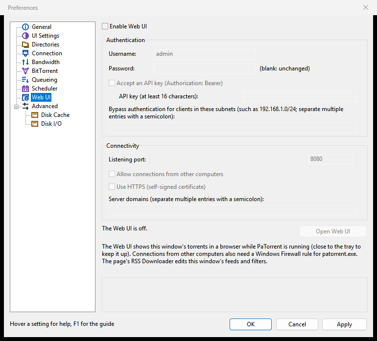

# Web UI

The Web UI is PaTorrent's main window in a web browser: the torrent list, the categories, the detail tabs, the right-click menu, Add, Preferences and the RSS Downloader. This page covers turning it on in the Windows program and in `patorrent-nox`, logging in, HTTPS, what the page can do, and using it on a phone.

There are two ways to get it:

- **From the Windows program.** `patorrent.exe` serves the page itself, over the window's own torrents, while it runs (**Options > Preferences > Web UI**).
- **From `patorrent-nox`**, the headless PaTorrent, started with `--webui` ([Running patorrent-nox](Running-patorrent-nox)). This is the way on Linux, BSD and macOS servers, and on a Windows PC that should keep downloading without a window.

The GTK program (Linux, BSD, macOS) does not serve a Web UI of its own. It can control a `patorrent-nox` through [Remote control](Remote-control) instead.

## Turning it on in the Windows program



1. Open **Options > Preferences** and choose **Web UI**.
2. Tick **Enable Web UI**.
3. Under **Authentication**, enter a **Username:** (`admin` is proposed) and a **Password:**. Both are needed; without them the page says "Please enter a user name and a password for the Web UI." The password is stored only as a hash. Later, leave the field empty to keep the stored one.
4. Under **Connectivity**, check the **Listening port:**. 8080 is proposed, or the next free port when another program or [profile](Profiles) holds it.
5. Click **Apply** or **OK**. The line at the bottom says "The Web UI is running: ..." with its address.
6. Click **Open Web UI** to open it in your browser.

The Web UI runs only while PaTorrent runs. Close the window to the tray to keep it up ([Tray, notifications and startup](Tray-notifications-and-startup)). It restarts when you apply changes on this page.

The other settings on the page:

| Setting | What it does |
|---|---|
| **Allow connections from other computers** | Listens on every network address, so other computers and phones can reach the page, not only this one. They also need a Windows Firewall rule for `patorrent.exe` ([Connection, ports and firewall](Connection-ports-and-firewall)). |
| **Use HTTPS (self-signed certificate)** | Serves the page over HTTPS with a certificate PaTorrent makes itself and keeps in the settings folder. Browsers warn about such a certificate until you accept it. |
| **Server domains (separate multiple entries with a semicolon):** | Host names the page answers to besides IP addresses and `localhost`, such as this computer's name. Other names are refused. See [Sonarr, Radarr and Prowlarr](Sonarr-Radarr-and-Prowlarr#host-names-and-docker). |
| **Accept an API key (Authorization: Bearer)** and **API key (at least 16 characters):** | Lets scripts and apps such as Sonarr or Radarr use the Web UI with this key instead of logging in. Off by default. The key is stored only as a hash and never shown again; leave the field empty to keep it. |
| **Bypass authentication for clients in these subnets (...)** | Clients in these networks (such as `192.168.1.0/24`) use the Web UI without logging in, with full control. List only networks you trust as much as the password. |

What is different from nox's page when the window serves it:

- The torrents, labels, settings and RSS feeds are the window's own. A change made in the browser shows in the window, and the other way round. The page's RSS Downloader edits the window's feeds and filters.
- The window's scheduler, seeding goal and move-completed folder do the work, as they do without the Web UI.
- There are no alternative rate limits.
- A window that controls a remote nox ([Remote control](Remote-control)) cannot serve the Web UI: "A remote window cannot serve the Web UI; use the local window's Preferences."

## Turning it on in patorrent-nox

Start nox with `--webui` and a port:

```sh
patorrent-nox run --save ~/Downloads --webui 8080
```

| `--webui` value | Who can reach the page |
|---|---|
| `8080` | This computer only (`127.0.0.1:8080`). |
| `0.0.0.0:8080` | Every computer that can reach this one. |
| `192.168.1.10:8080` | Computers that reach this one at that address. |

The login name is `admin` unless you give `--webui-user`. The first start, with no password stored, prints a temporary one:

```text
* Web UI: no password set; temporary password for this run: ... (set one with --webui-pass)
```

Log in with it, then set your own in the page's **Preferences > Web UI** (the **Password:** field, with the temporary one as the **Current password:**). `--webui-pass` also sets it, but a password on the command line can be seen by other users of the computer.

A nox running as a service writes the temporary password to its log or the journal: see [Running patorrent-nox](Running-patorrent-nox).

## Logging in

Open the address in a browser: `http://127.0.0.1:8080/` on the same computer, or `http://<the computer's address>:8080/` from another one (`https://` when HTTPS is on). Enter the **User name** and **Password** and click **Log in**. **Log out** is at the right end of the toolbar.

- After five wrong logins in a row from one address, that address is locked out for an hour. Both numbers are in **Preferences > Web UI**.
- A login ends after an hour without a request from that browser (**Session timeout (seconds):**).
- Setting a new password logs out every other browser and remote window; the one that changed it stays logged in.
- When the connection to PaTorrent drops, the status bar shows "Disconnected, reconnecting in ... s" and the page connects again by itself.

## HTTPS

Without HTTPS, the password and everything the page shows cross the network unencrypted. On your own computer that does not matter; across a network, turn HTTPS on.

- **Windows program:** tick **Use HTTPS (self-signed certificate)** in **Preferences > Web UI**.
- **nox:** add `--webui-https`. nox makes a certificate on first use, keeps it in its settings folder (`webui-cert.pem`, `webui-key.pem`) and renews it a month before it expires. At every start it prints a line like `* Web UI: certificate SHA-256 ...`.
- **nox with your own certificate:** `--webui-cert FILE --webui-key FILE` (PEM; the key not encrypted).

The browser warns about a self-signed certificate the first time. Compare the fingerprint the browser shows with the `certificate SHA-256` line nox printed, then accept it. With HTTPS on, a plain `http://` address to the same port is sent on to `https://`.

## What the page can do

The page follows the desktop window: the same columns, menus, words and order.

- **Toolbar:** **Add Torrent**, **Add URL**, **Remove**, **Start**, **Pause**, **Stop**, **Up** and **Down** (queue order), **RSS**, **Preferences** (<kbd>Ctrl</kbd>+<kbd>P</kbd>), the search box that filters the list, **Find**, and **Log out**.
- **Categories** on the left with their counts, including the labels and the RSS feeds.
- **The torrent list:** click a header to sort, drag headers to reorder or resize, right-click a header to choose columns (**Reset Columns** puts them back).
- **The detail tabs** under the list: General, Trackers, Peers, Pieces, Files, Speed and Logger ([Torrent details and files](Torrent-details-and-files)).
- **The right-click menu** has what the window's menu has: **Force Start**, **Start**, **Pause**, **Stop**, the queue moves, **Remove** and **Remove And > Delete Data**, **Force Re-Check**, **Update Tracker**, **Advanced > Set Download Location...** and **Initial Seeding**, **Bandwidth Allocation**, **Label**, and **Properties** ([Managing torrents](Managing-torrents)). **Open Containing Folder** is grey: a browser cannot open a folder on the server.
- **Adding torrents:** **Add Torrent** uploads `.torrent` files from the computer the browser runs on. **Add URL** takes a magnet link, an info-hash or an `http://` link to a torrent. You can also drop `.torrent` files or a magnet link onto the page, or paste a magnet link anywhere outside a text box. With "Show a window that displays the files inside the torrent" on (**Preferences > UI Settings**, on by default), an Add dialog asks the same as the desktop one: save folder, name, label, which files, start or not. For a magnet link it opens once the torrent's file list has arrived. See [Adding torrents](Adding-torrents).
- **Torrent Properties:** trackers, speed limits, upload slots and the seeding goal of the selected torrents.
- **Preferences:** the pages General, UI Settings, Directories, Connection, Bandwidth, BitTorrent, Queueing, Scheduler, Web UI, Advanced, Disk Cache and Disk I/O. Hover over a setting for its help, or press <kbd>F1</kbd> (*the help texts are new in 1.1.57; not in a published release yet*). Folders are folders on the server, typed as text. See [Preferences reference](Preferences-reference).
- **RSS Downloader:** feeds, filters and history, as in the desktop program ([RSS Downloader](RSS-Downloader)).
- **Find** opens Search Torrents, which searches your Prowlarr or Jackett; **Manage Sources...** there adds them ([Searching for torrents](Searching-for-torrents)). Adding a source, or changing its address or key, asks for the current Web UI password.

Keys in the list: arrows, <kbd>Home</kbd>, <kbd>End</kbd>, <kbd>Page Up</kbd>, <kbd>Page Down</kbd> move; <kbd>Shift</kbd> and <kbd>Ctrl</kbd> with a click or a key extend the selection; <kbd>Ctrl</kbd>+<kbd>A</kbd> selects every torrent the filter shows; <kbd>Space</kbd> pauses; <kbd>Delete</kbd> removes; <kbd>Shift</kbd>+<kbd>Delete</kbd> removes and deletes the data; the <kbd>Menu</kbd> key or <kbd>Shift</kbd>+<kbd>F10</kbd> opens the right-click menu.

The page uses the language set in **Preferences > General**, "User interface". It turns dark when your browser or system is set to a dark theme.

## On a phone

The same address works on a phone; the page changes its layout on a narrow screen (under 768 pixels wide).

- The list shows each torrent's name over a progress bar with its status, speeds and time left.
- The categories are in a drawer behind the menu button at the start of the toolbar.
- Tap a torrent to see its details in a sheet from the bottom.
- The button on each row opens its menu. A long press starts selecting several torrents; tap more to add them, and **Done** ends the selection.
- The toolbar keeps **Add**, **Start**, **Pause** and **Remove**; the rest, and sorting, are under **More**.
- On Android the Back button closes the topmost drawer, sheet or dialog.

For the phone to reach the page, the Web UI must accept connections from other computers (**Allow connections from other computers**, or nox's `--webui 0.0.0.0:PORT`), and the phone must be on a network that reaches the computer.

## Security

The Web UI controls your torrents and can write files wherever PaTorrent's account can. Keep these in mind before opening it to a network:

- Use a long password, and turn on HTTPS for anything beyond your own computer.
- **Enable Host header validation** (on by default) refuses requests addressed to any name but an IP address, `localhost` or a listed server domain. **Enable Cross-Site Request Forgery (CSRF) protection** (on by default) refuses changes sent from another web site's page. Leave both on.
- **Bypass authentication for clients on localhost** (nox's page; off by default) lets programs on the same computer in without a login. It and the subnet list never apply to requests that come through a reverse proxy.
- Changing the login, the API key, the subnets or the other security settings in the page needs the **Current password:**. A wrong one logs that browser out.
- With nox, `--webui-save-root DIR` limits the folders the Web UI may save to, move to and read from ([Running patorrent-nox](Running-patorrent-nox#web-ui)).

Behind a reverse proxy on the same computer, have the proxy set the `X-Forwarded-For` header, so that failed logins lock out the right client and not everyone.

## See also

- [Remote control](Remote-control): the desktop program's window driving a nox, as an alternative to the page.
- [Sonarr, Radarr and Prowlarr](Sonarr-Radarr-and-Prowlarr): using the Web UI's qBittorrent-compatible API.
- The design behind the page: [WEBUI.md](https://github.com/Balls0fSteel/PaTorrent/blob/main/docs/WEBUI.md).
